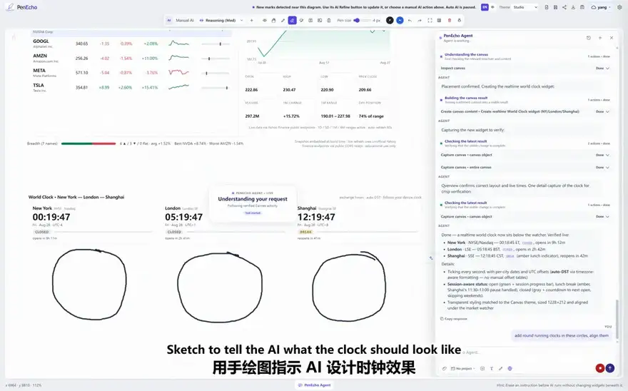
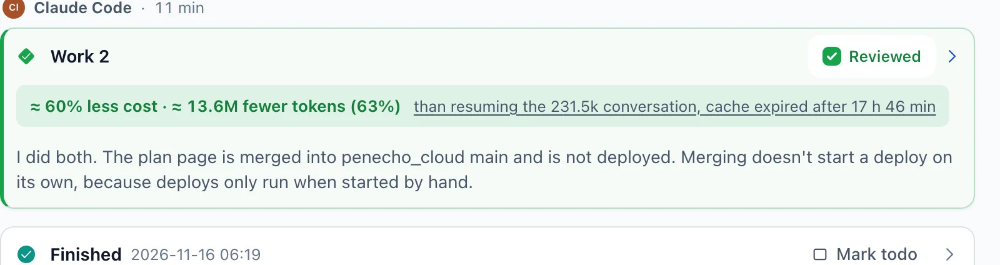
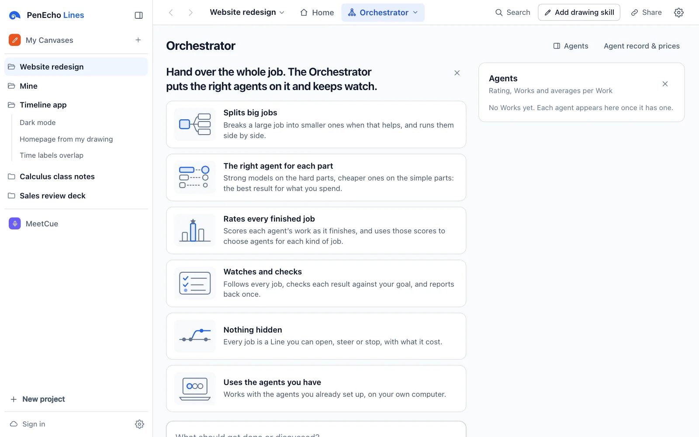
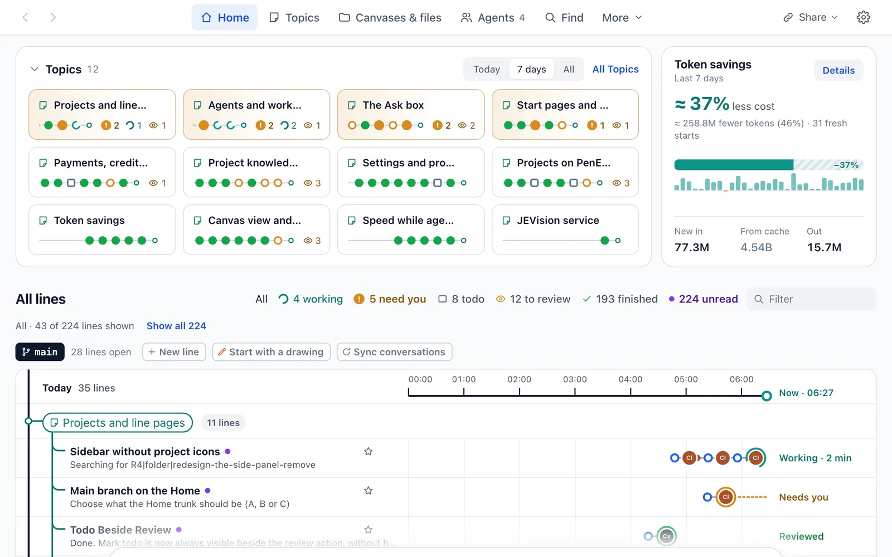
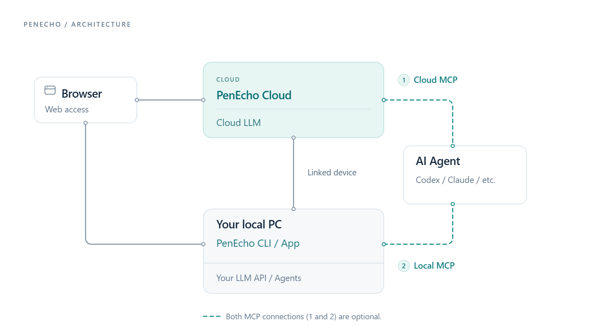

<p align="center">
  <a href="https://penecho.ai/lines.html">
    <picture>
      <source media="(prefers-color-scheme: dark)" srcset="docs/assets/penecho-lines-logo-dark.svg">
      
    </picture>
  </a>
</p>

<h3 align="center">Not another AI agent. A better way to work with yours.</h3>

<p align="center">
  A brand-new way to interact with AI agents: draw what you mean, and follow every job as a line.<br>
  Works with the agents you already use. Open source, free on your computer, no account required.
</p>

<p align="center">
  <a href="https://github.com/penecho/penecho/releases"></a>
</p>

<p align="center">
  <a href="https://penecho.ai">Website</a> &nbsp;·&nbsp;
  <a href="#quick-start">Download</a> &nbsp;·&nbsp;
  <a href="https://penecho.ai/try.html">Try in browser</a> &nbsp;·&nbsp;
  <a href="https://penecho.ai/leaderboard">Agent leaderboard</a> &nbsp;·&nbsp;
  <a href="https://discord.gg/3jrPJ3mXdX">Discord</a> &nbsp;·&nbsp;
  <a href="https://buymeacoffee.com/penecho">Buy me a coffee</a>
</p>

<p align="center">
  <sub>
    <strong>English</strong> ·
    <a href="docs/readme/README.zh-CN.md">简体中文</a> ·
    <a href="docs/readme/README.ja.md">日本語</a> ·
    <a href="docs/readme/README.ko.md">한국어</a> ·
    <a href="docs/readme/README.ru.md">Русский</a> ·
    <a href="docs/readme/README.es.md">Español</a> ·
    <a href="docs/readme/README.pt-BR.md">Português</a> ·
    <a href="docs/readme/README.fr.md">Français</a> ·
    <a href="docs/readme/README.de.md">Deutsch</a>
  </sub>
</p>

---

## A brand-new way to interact with agents

Most agents give you a text box. PenEcho gives you a pen. Circle what is wrong, draw an arrow to where something belongs, sketch the shape you want. Your agent sees your strokes together with your words and changes the result in place.

<p align="center">
  
</p>
<p align="center"><sub>Draw three circles and they become running clocks. Draw an arrow and the stock is added where it points.</sub></p>

<table width="100%">
  <tr>
    <td width="50%" valign="top">
      <br>
      <strong>Sketch and ask</strong><br>
      Handwriting, equations, drawings, and mazes. The answer lands where you wrote.
    </td>
    <td width="50%" valign="top">
      <br>
      <strong>Drawing skills</strong><br>
      Molecules, charts, class models, database schemas, force diagrams, and circuits. Mark a correction by hand and only that part changes.
    </td>
  </tr>
  <tr>
    <td width="50%" valign="top">
      <a href="https://penecho.ai/#knows-you"></a><br>
      <strong>It knows the next step</strong><br>
      Pause, and PenEcho suggests what comes next: solve, plot, animate, simulate, or explain.
    </td>
    <td width="50%" valign="top">
      <br>
      <strong>Working widgets</strong><br>
      Write what you want, use it on the Canvas, then circle a part to change it.
    </td>
  </tr>
</table>

### Professional diagrams

Architecture, sequence, and workflow diagrams that stay editable, with automatic layout and SVG or PNG export.

<table width="100%">
  <tr>
    <td width="33%" valign="top"><a href="docs/assets/professional-diagrams/kubernetes.webp"></a><br><sub><strong>Kubernetes cluster</strong> · Architecture</sub></td>
    <td width="33%" valign="top"><a href="docs/assets/professional-diagrams/migration.webp"></a><br><sub><strong>Monolith → microservices</strong> · Architecture</sub></td>
    <td width="33%" valign="top"><a href="docs/assets/professional-diagrams/notifications.webp"></a><br><sub><strong>Event-driven notifications</strong> · Sequence</sub></td>
  </tr>
  <tr>
    <td valign="top"><a href="docs/assets/professional-diagrams/mcp-request.webp"></a><br><sub><strong>How MCP reaches the Canvas</strong> · Sequence</sub></td>
    <td valign="top"><a href="docs/assets/professional-diagrams/release.webp"></a><br><sub><strong>Release: parallel tasks</strong> · Workflow</sub></td>
    <td valign="top"><a href="docs/assets/professional-diagrams/rollout.webp"></a><br><sub><strong>Multi-region rollout</strong> · Workflow</sub></td>
  </tr>
</table>

---

## Every job is a line

Each task you give an agent becomes a Line, from your Ask to the reviewed result.

<p align="center">
  <a href="https://penecho.ai/lines.html#film">
    
  </a>
</p>
<p align="center">
  <a href="https://penecho.ai/lines.html#film">Watch PenEcho Lines in 2 minutes</a> &nbsp;·&nbsp;
  <a href="https://github.com/penecho/penecho/releases/download/v0.1.0/penecho_lines.mp4">Download MP4</a> &nbsp;·&nbsp;
  <a href="https://penecho.ai/lines.html">Interactive tour</a>
</p>

<a name="features"></a>

<a name="feature-01"></a>

### Agents collaborate on one task

Every feature, fix, or research question lives on a single **Line**. Instead of copying prompts and snippets across separate apps, let one agent design, another implement, and a third review—reading the exact same Line record in order, or coordinated end-to-end by the Orchestrator.

<table width="100%">
  <tr>
    <td width="33%" valign="top">
      <br><br>
      <strong>1. Ask</strong><br>
      Describe the task—or pick Diagram, Explorer, Slides, Note card, or MeetCue when you want visual output back.
    </td>
    <td width="33%" valign="top">
      <br><br>
      <strong>2. Any agent works</strong><br>
      Run with any saved agent or switch models mid-Line. Progress updates live, and runs keep going even if PenEcho restarts.
    </td>
    <td width="33%" valign="top">
      <br><br>
      <strong>3. Review &amp; hand off</strong><br>
      Inspect the diff or Canvas result, mark it reviewed, or add the next Ask on the same Line for another agent to pick up.
    </td>
  </tr>
</table>

<a name="feature-02"></a>

### True token savings, with proof

Ordinary chat sessions resend their entire conversation history on every turn. PenEcho automatically decides when to continue a warm session and when to start fresh on the same Line—passing compact, bounded context plus pointers to full records rather than 200k tokens of old chat.

<p align="center">
  
</p>

- **Measured on real work:** **about a third cheaper** (≈ 33% less cost and 51% fewer tokens across 49 real development tasks) compared with resuming the same long conversation. Long multi-step Lines save the most; brief follow-ups keep warm cache.
- **Per-task proof with zero overhead:** Every finished Work shows how many tokens and dollars were saved and why—calculated locally from real agent counters without any extra LLM call.

<a name="feature-03"></a>

### Smarter Orchestrator & real ratings

Hand a complex, multi-part job to the **Orchestrator**. It plans the route before starting, dispatches independent parts across your saved agents in parallel, checks each result against your goal, and reports back once.

<p align="center">
  
</p>

- **Cost-efficient routing:** Assigns strong models to architecture and difficult reasoning, and faster, lower-cost models to routine or scoped tasks—optimizing quality per dollar.
- **Continuous rating feedback:** Every finished task is rated on actual verified output alongside your own feedback, teaching the Orchestrator which agent, model, and effort excel at each kind of job.
- **Real-task Statistics:** Track quality, latency, and exact model-price cost per agent, model, and effort across Code, Design, Research, Docs, and Chat—powering both manual picks and the public [Real-World AI Agent Leaderboard](https://penecho.ai/leaderboard).
- **Nothing hidden:** No black box: every delegated part is an ordinary Line you can open, inspect, steer, or stop at any moment.

<a name="feature-04"></a>

### Auto-sync across every agent

Keep working in your agents' native apps and CLIs whenever you prefer—PenEcho automatically watches and syncs sessions into your project so nothing is stranded inside a single tool.

Works with Claude Code, Codex, OpenCode, Antigravity, Kimi, Pi, DeepSeek Harness, omp, and PenEcho's built-in runner.

- **Never lose history:** every agent's conversation and file edits appear on the project timeline automatically.
- **Continue anywhere:** hand any synced session to a different agent, move your project folder to a new computer, or sync through optional [PenEcho Cloud](https://penecho.ai).

<a name="feature-05"></a>

### Full job lifecycle at scale

Terminal tabs fall apart once ten agents are coding, researching, and reviewing in parallel. PenEcho manages the complete lifecycle—**Ask → Working → Needs you → To review → Done**—keeping hundreds of concurrent Lines structured and calm on a single screen.

<p align="center">
  
</p>

- **Instant focus at scale:** One-click filters surface **Needs you** and **To review** out of 100+ active Lines, alongside Todo tracking and unread markers.
- **Git-aware code workflow:** Link a code repository and each branch displays as a Line on main; agents work safely while only you merge.

<a name="feature-06"></a>

### Draw feedback on any Line

Draw on screenshots, prototypes, diagrams, or slides while the Line stays open beside the Canvas. Your marks go to the agent with your prompt.

<table width="100%">
  <tr>
    <td width="50%" valign="top">
      <br><br>
      <strong>You circle a block</strong> and write: <em>"Move what I circled into the docs folder box."</em>
    </td>
    <td width="50%" valign="top">
      <br><br>
      <strong>The agent sees your strokes with your words</strong> and updates the Canvas in place.
    </td>
  </tr>
</table>

- **Editable Diagrams:** Architecture, sequence, and workflow diagrams with automatic local layout and clean SVG / PNG export.
- **Interactive Explorers & Widgets:** Runnable UI prototypes, calculators, simulations, and live 2D / 3D graphs directly on the Canvas.
- **Slides & Note Cards:** Generate structured slide decks and export editable PowerPoint (.pptx) files with native charts, or save reusable knowledge cards.
- **Handwriting, Math & MeetCue:** Endless canvas for freehand ink, equations, and Smart Assist—plus **MeetCue** live meeting maps checked against your project files.

<a name="feature-07"></a>

### Plain Markdown Lines & Topics

Every Line is a clean Markdown file stored directly in your own folder—zero proprietary database, zero lock-in. As tasks finish, PenEcho automatically distills your AI work into **Topics**: living requirement documents with owner decisions, current status, and linked task history, stored in plain Markdown too.

<p align="center">
  
</p>

```text
your-project/
├── MEMORY.md       # Project-wide rules and decisions every agent reads before starting
├── topics/         # Auto-summarized requirement docs with status and linked Line history
├── lines/          # One plain .md file per task (Ask → Working → Reviewed)
├── works/          # Detailed agent runs, verification notes, and token-savings proofs
└── files/          # Canvases, diagrams, screenshots, and slide decks
```

- **Read and version anywhere:** Open, grep, diff, or edit in Git, VS Code, Obsidian, or any mobile Markdown viewer.
- **Ask your project:** Ask how anything stands and a saved agent answers with direct links back to the underlying Lines and Topics.

<a name="feature-08"></a>

### Easy project & Canvas sharing

Bring teammates in with a single link—no local setup or account friction required.

- **Project link:** Share an entire project's Lines, Topics, and Canvases via a live-updating link; optionally let teammates leave written or drawn feedback directly onto a Line.
- **Live Canvas collaboration:** One click starts a live Canvas session where teammates and AI agents draw and annotate together in real time—with no account required to join.
- **Portable exports:** Download any Canvas as a clean **PDF**, diagrams as **SVG / PNG**, or slide decks as editable **PowerPoint (.pptx)**.

---

<a name="whats-new-in-v150"></a>

## What's New in 1.5.0

- **PenEcho Lines:** every job from Ask to Done, across all your agents, in plain Markdown files.
- **Token savings with proof:** PenEcho continues or starts fresh, whichever costs less, and shows the saving on each Work.
- **Orchestrator and ratings:** splits big jobs across your agents, checks the results, and learns which agent does what best.
- **Live Canvas and sharing:** draw together through a link with no account, share a project, or export PDF and PowerPoint.
- **Folder projects:** agents working in one folder share one set of auto-saving Canvases.
- **MeetCue:** live meeting maps checked against your project files.

Full notes are in the [changelog](CHANGELOG.md#150).

---

## Quick Start

- **Desktop app:** download for macOS or Windows from the [latest release](https://github.com/penecho/penecho/releases/latest).
- **npm:** needs Node.js 22.19 or newer.
- **Browser:** open [penecho.ai](https://penecho.ai), nothing to install.

```text
npm install -g penecho
penecho
```

PenEcho opens at http://localhost:3888. On first launch, choose a six-digit access code (or open access on a trusted local network), open a project folder, and connect your agents in **Settings → Agents**.

<details>
<summary>Run from source</summary>

```text
git clone https://github.com/penecho/penecho.git
cd penecho
npm install
npm start
```

</details>

---

## Connect Your AI Agent

**Inside a PenEcho project**, add your installed agents in **Settings → Agents**—Claude Code, Codex, OpenCode, Antigravity, Kimi, Pi, dsh, or omp—and run or sync any Line directly.

**For a visual Canvas beside any chat** (Claude Code, Codex, Cursor, or any MCP client), paste one line:

```text
Set up PenEcho for me by following https://penecho.ai/agents.md
```

Then ask directly in your chat:

- *"Draw this project's architecture on the canvas."*
- *"Turn our authentication flow into a sequence diagram on the canvas."*
- *"Read my handwritten notes on the canvas and revise the diagram."*

The Canvas opens beside your conversation. No account is required (choose **Continue as guest** if prompted), and MCP uses no PenEcho credits.

<details>
<summary>Manual Local MCP setup (global npm install)</summary>

Enable MCP in **Settings → MCP** and click **Auto configure**, or add this entry to any client supporting mcpServers JSON:

```text
{
  "mcpServers": {
    "penecho": {
      "command": "penecho",
      "args": ["mcp"]
    }
  }
}
```

Agents only see Canvases you explicitly enable. Local MCP stays on your machine; Cloud MCP uses separate OAuth authorization. See the [MCP Setup Guide](docs/mcp-setup.md) and [Plugin Installation](integrations/penecho-cloud/INSTALL.md).

</details>

---

## How It Works

<p align="center">
  
</p>

- **On your computer:** The desktop app or CLI runs your local agents in your project folder. Lines, Topics, and MEMORY.md stay plain Markdown files on your disk. Free, no account required.
- **PenEcho Cloud (penecho.ai):** Optional. Adds hosted models, multi-device project sync, live-updating share links, teammate visual notes, and real-time Canvas collaboration.
- **Your AI agent (MCP):** Connects through Local MCP or Cloud MCP—both optional and scoped strictly to Canvases you enable.

Further reading: [Architecture Notes](docs/architecture.md) · [Project Lines Specification](docs/project-lines.md)

---

## Choose Your AI

| Connection | Billing | Best For |
| :--- | :--- | :--- |
| **Your Agent CLI** (Claude Code, Codex, OpenCode, Kimi, etc.) | Your existing subscription | Reusing the agent plans you already pay for |
| **Your Model API** (OpenAI- or Anthropic-compatible) | Your API provider | Direct control over models, routing, and spend |
| **PenEcho Models** (sign in at penecho.ai) | Account credits | Getting started immediately with no API keys |

Rather than pinning a static model table that dates quickly, **Statistics** tracks real quality, speed, and cost across your own projects—and the public [PenEcho Real-World AI Agent Leaderboard](https://penecho.ai/leaderboard) aggregates real-task performance across job types.

---

<a name="buy-us-a-coffee"></a>
<a name="support-penecho"></a>

## Support PenEcho

PenEcho is open source and free on your computer, with no account required. If it saved you an afternoon—or a few million tokens—buying us a coffee goes directly toward development, testing, and documentation.

[Buy me a coffee](https://buymeacoffee.com/penecho) · [GitHub Sponsors](https://github.com/sponsors/penecho)

A star, a thoughtful bug report, or sharing PenEcho with a colleague helps just as much. Contributions support open-source maintenance; they do not purchase a commercial license, dedicated support, or guaranteed features.

---

## Community & License

[Website](https://penecho.ai) · [Leaderboard](https://penecho.ai/leaderboard) · [Discord](https://discord.gg/3jrPJ3mXdX) · [Discussions](https://github.com/penecho/penecho/discussions) · [Issues](https://github.com/penecho/penecho/issues) · [Contributing](CONTRIBUTING.md)

Licensed under [AGPL-3.0-only](LICENSE); a [Commercial License](COMMERCIAL-LICENSE.md) is available. See [Trademark Policy](TRADEMARKS.md) · [Contributor License Agreement](CONTRIBUTOR-LICENSE-AGREEMENT.md) · [Changelog](CHANGELOG.md).

Diagram renderers adapt SVG and geometry helpers from [Archify](https://github.com/tt-a1i/archify) by tt-a1i (MIT). See [NOTICE](NOTICE).

<br>

<p align="center">
  <a href="https://www.kimi.com/code?aff=penecho">
    <picture>
      <source media="(prefers-color-scheme: dark)" srcset="docs/assets/kimi-open-source-friends-dark.svg">
      
    </picture>
  </a>
</p>

<details>
<summary><strong>Star History</strong></summary>
<br>
<p align="center">
  <a href="https://www.star-history.com/?repos=penecho%2Fpenecho&amp;type=date&amp;legend=top-left">
    <picture>
      <source media="(prefers-color-scheme: dark)" srcset="https://api.star-history.com/chart?repos=penecho/penecho&amp;type=date&amp;theme=dark&amp;legend=top-left">
      
    </picture>
  </a>
</p>
</details>
