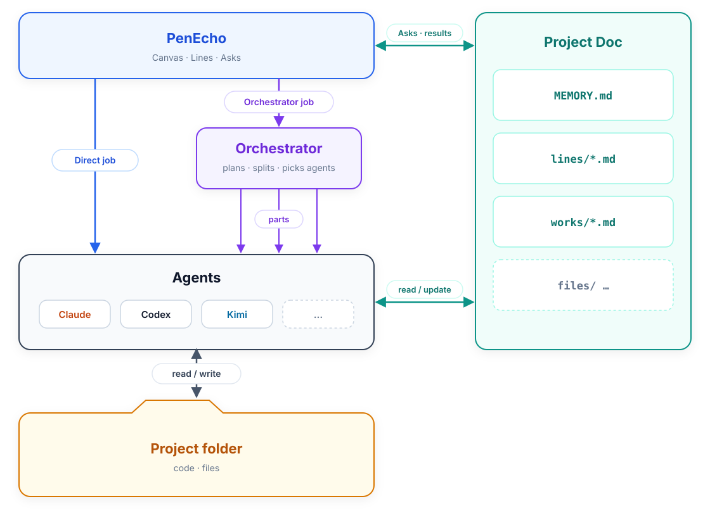

<p align="center">
  <a href="https://penecho.ai/lines.html">
    <picture>
      <source media="(prefers-color-scheme: dark)" srcset="docs/assets/penecho-lines-logo-dark.svg">
      
    </picture>
  </a>
</p>

<h3 align="center">Not another AI agent. A better way to work with yours.</h3>

<p align="center">
  Draw what you mean, follow every job as a line, and let one agent check another's work.<br>
  Works with the agents you already use. Open source, free on your computer, no account needed.
</p>

<p align="center">
  <a href="https://penecho.ai">Website</a> &nbsp;·&nbsp;
  <a href="#install">Download</a> &nbsp;·&nbsp;
  <a href="https://penecho.ai/try.html">Try in browser</a> &nbsp;·&nbsp;
  <a href="https://penecho.ai/leaderboard">Agent leaderboard</a> &nbsp;·&nbsp;
  <a href="https://discord.gg/3jrPJ3mXdX">Discord</a> &nbsp;·&nbsp;
  <a href="https://buymeacoffee.com/penecho">Buy me a coffee</a>
</p>

<p align="center">
  <sub>
    <strong>English</strong> ·
    <a href="docs/readme/README.zh-CN.md">简体中文</a> ·
    <a href="docs/readme/README.ja.md">日本語</a> ·
    <a href="docs/readme/README.ko.md">한국어</a> ·
    <a href="docs/readme/README.ru.md">Русский</a> ·
    <a href="docs/readme/README.es.md">Español</a> ·
    <a href="docs/readme/README.pt-BR.md">Português</a> ·
    <a href="docs/readme/README.fr.md">Français</a> ·
    <a href="docs/readme/README.de.md">Deutsch</a>
  </sub>
</p>

---

<a name="quick-start"></a>

## Install

<a href="https://github.com/penecho/penecho/releases/latest"></a>

<a href="LICENSE"></a>

| | |
| :--- | :--- |
| **Desktop app** | Download for macOS or Windows from [penecho.ai](https://penecho.ai/downloads.html). |
| **npm** | `npm install -g penecho`, then `penecho` (Node.js 22.19 or newer). |
| **Browser** | Open [penecho.ai](https://penecho.ai). Nothing to install. |

Choose an access code, open a project folder, and add your agents in **Settings → Agents**. Use the agent plans you already pay for, your own API key, or PenEcho models.

New in 1.5.0: Lines, one-click review, the Orchestrator with real ratings, token savings with proof, and live Canvas sharing. See the [changelog](CHANGELOG.md#150).

### Run from source

You need Git and Node.js 22.19 or newer. The built pages are part of the repository, so there is no build step.

```bash
git clone https://github.com/penecho/penecho.git
cd penecho
npm install
npm start        # PenEcho opens at http://localhost:3888
```

For the desktop app from source, run `npm run desktop:deps` once, then `npm run desktop`. `npm run check` runs every check and test.

---

## See it in 3 minutes

One real job from start to finish: one agent builds, another reviews, the fixes go back, and you make the last call.

<p align="center">
  <a href="https://penecho.ai/lines.html#film">
    
  </a>
</p>
<p align="center"><a href="https://penecho.ai/lines.html#film">▶ Watch the full film</a></p>

<p align="center">
  
</p>

Send a job straight to one agent, or hand it to the Orchestrator, which splits it and picks an agent for each part. Every agent works in your folder and keeps the same plain Markdown record.

---

## What you get

<table width="100%">
  <tr>
    <td width="50%" valign="top">
      <strong>Agents work together on one job</strong><br>
      One agent builds, another reviews in one click, and <em>Send fixes</em> hands findings back on the same Line.
    </td>
    <td width="50%" valign="top">
      <strong>Token savings, with proof</strong><br>
      Continues or starts fresh, whichever costs less, and shows what every job saved.
    </td>
  </tr>
  <tr>
    <td width="50%" valign="top">
      <strong>An Orchestrator that learns</strong><br>
      Splits big jobs, picks agents by their real record, and rates every result so picks improve over time.
    </td>
    <td width="50%" valign="top">
      <strong>Every agent, synced</strong><br>
      Sessions from Claude Code, Codex, Kimi, OpenCode and more sync in. Continue any of them with any agent.
    </td>
  </tr>
  <tr>
    <td width="50%" valign="top">
      <strong>Hundreds of jobs on one screen</strong><br>
      Ask, Working, Needs you, To review, Done. See at a glance what waits for you.
    </td>
    <td width="50%" valign="top">
      <strong>Draw what you mean</strong><br>
      Circle a screenshot, sketch a prototype, make diagrams and slides. Agents see your marks with your words.
    </td>
  </tr>
  <tr>
    <td width="50%" valign="top">
      <strong>Plain Markdown you own</strong><br>
      Every Line is a Markdown file in your folder, with one <code>MEMORY.md</code> for the project. Read it anywhere.
    </td>
    <td width="50%" valign="top">
      <strong>Share with one link</strong><br>
      Share a project or a Canvas with a link. Teammates open it in a browser to review and draw notes.
    </td>
  </tr>
</table>

Works with Claude Code, Codex, OpenCode, Antigravity, Kimi, Pi, DeepSeek Harness, omp, and PenEcho's built-in runner.

---

## Canvas AI

Write, sketch, or circle something, and the answer lands right where you drew.

<p align="center">
  
</p>
<p align="center"><sub><strong>Sketch and ask</strong> — handwriting, equations, drawings, and mazes.</sub></p>

---

## Kimi Open Source Friends

<p align="center">
  <a href="https://www.kimi.com/code?aff=penecho">
    <picture>
      <source media="(prefers-color-scheme: dark)" srcset="docs/assets/kimi-open-source-friends-dark.svg">
      
    </picture>
  </a>
</p>

PenEcho is one of the Kimi Open Source Friends. Kimi Code runs in PenEcho like any other agent: add it in **Settings → Agents**, or [get Kimi Code](https://www.kimi.com/code?aff=penecho).

---

<a name="support-penecho"></a>
<a name="buy-us-a-coffee"></a>

## More

- **Community:** [Website](https://penecho.ai) · [Leaderboard](https://penecho.ai/leaderboard) · [Discord](https://discord.gg/3jrPJ3mXdX) · [Discussions](https://github.com/penecho/penecho/discussions) · [Issues](https://github.com/penecho/penecho/issues) · [Contributing](CONTRIBUTING.md)
- **Support:** if PenEcho saved you an afternoon, [buy us a coffee](https://buymeacoffee.com/penecho) or [sponsor on GitHub](https://github.com/sponsors/penecho). A star or a good bug report helps just as much.
- **Docs:** [Architecture](docs/architecture.md) · [Project Lines](docs/project-lines.md) · [MCP setup](docs/mcp-setup.md) · [Changelog](CHANGELOG.md)
- **License:** [AGPL-3.0-only](LICENSE), with a [commercial license](COMMERCIAL-LICENSE.md) available. See the [trademark policy](TRADEMARKS.md) and [CLA](CONTRIBUTOR-LICENSE-AGREEMENT.md). Diagram renderers adapt code from [Archify](https://github.com/tt-a1i/archify) by tt-a1i (MIT); see [NOTICE](NOTICE).

<details>
<summary><strong>Star history</strong></summary>
<br>
<p align="center">
  <a href="https://www.star-history.com/?repos=penecho%2Fpenecho&amp;type=date&amp;legend=top-left">
    <picture>
      <source media="(prefers-color-scheme: dark)" srcset="https://api.star-history.com/chart?repos=penecho/penecho&amp;type=date&amp;theme=dark&amp;legend=top-left">
      
    </picture>
  </a>
</p>
</details>
