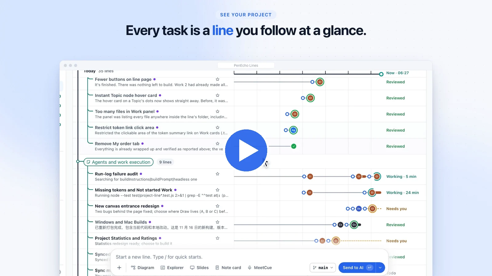
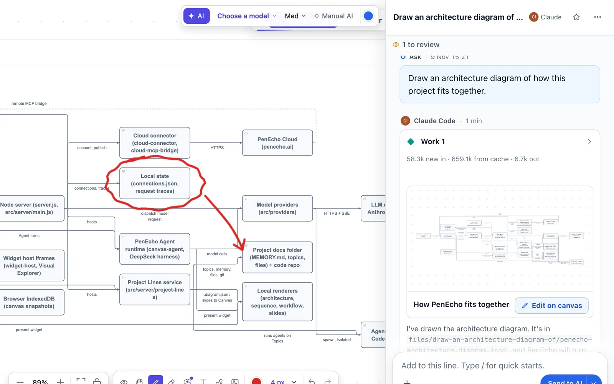
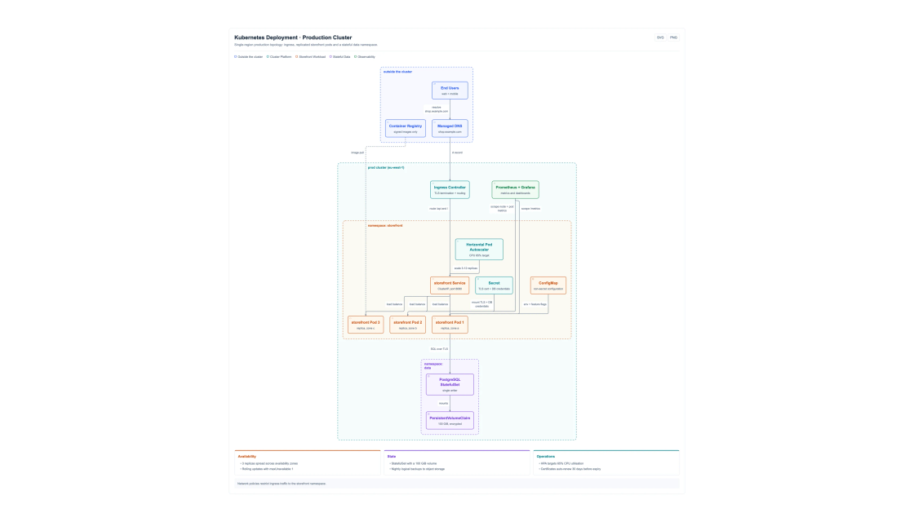
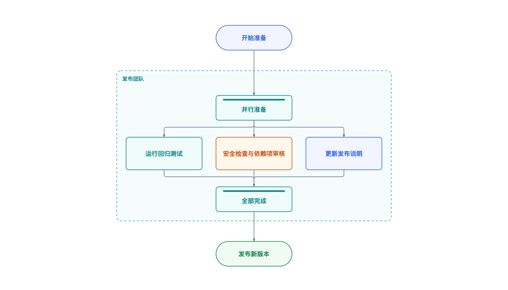

<p align="center">
  <picture>
    <source media="(prefers-color-scheme: dark)" srcset="../../public/penecho-readme-header-dark.webp">
    
  </picture>
</p>

<h1 align="center">Nicht noch ein KI-Agent. Eine bessere Art, mit Ihren zu arbeiten.</h1>

<p align="center">Jede Aufgabe, die Sie Claude Code, Codex oder einem anderen Agenten geben, wird zu einer Linie, die Sie auf einen Blick verfolgen – von Ihrem Ask bis zur geprüften Arbeit.<br>Lange Arbeit kostet etwa die Hälfte, und wenn Worte nicht reichen, zeichnen Sie auf dem Canvas, was Sie meinen.</p>

<p align="center">
  <a href="https://github.com/penecho/penecho/releases"></a>
  <a href="https://www.npmjs.com/package/penecho"></a>
  <a href="../../LICENSE"></a>
  <a href="https://discord.gg/3jrPJ3mXdX"></a>
  <a href="../mcp-setup.md"></a>
</p>

<p align="center">
  <a href="https://github.com/penecho/penecho/releases"></a>
  <a href="https://github.com/penecho/penecho/releases"></a>
  <a href="https://penecho.ai"></a>
  <a href="https://buymeacoffee.com/penecho"></a>
</p>

<p align="center">
  <a href="#why-work-on-lines">Warum Linien</a> ·
  <a href="#from-ask-to-reviewed">So funktioniert es</a> ·
  <a href="#hand-over-the-whole-job">Orchestrator</a> ·
  <a href="#quick-start">Schnellstart</a> ·
  <a href="#connect-your-ai-agent">Agent verbinden</a> ·
  <a href="#whats-new-in-150">Neu in 1.5</a> ·
  <a href="#buy-us-a-coffee">Spendieren Sie uns einen Kaffee</a>
</p>

<p align="center">
  <sub><a href="../../README.md">English</a> ·
  <a href="README.zh-CN.md">简体中文</a> ·
  <a href="README.ja.md">日本語</a> ·
  <a href="README.ko.md">한국어</a> ·
  <a href="README.ru.md">Русский</a> ·
  <a href="README.es.md">Español</a> ·
  <a href="README.pt-BR.md">Português</a> ·
  <a href="README.fr.md">Français</a> ·
  <strong>Deutsch</strong></sub>
</p>

<p align="center">
  <a href="https://penecho.ai/lines.html#film"></a>
</p>
<p align="center"><a href="https://penecho.ai/lines.html#film"><strong>▶ PenEcho Lines in 2 Minuten ansehen</strong></a> · <a href="https://github.com/penecho/penecho/releases/download/v0.1.0/penecho_lines.mp4">MP4 herunterladen</a></p>

<p align="center"><sub>Open Source und kostenlos auf Ihrem Computer. Wenn PenEcho Ihnen Zeit spart, hält <a href="https://buymeacoffee.com/penecho">ein Kaffee ☕</a> es am Laufen.</sub></p>

<a name="why-work-on-lines"></a>

## Warum auf Linien arbeiten

<p align="center"></p>

<sub>Die Ersparnis wird mit dem Fortsetzen derselben Unterhaltung verglichen; lange Arbeit spart also am meisten, kurze Aufgaben weniger.</sub>

<a name="from-ask-to-reviewed"></a>

## Vom Ask bis Geprüft

<table width="100%">
  <tr>
    <td width="33%" valign="top">
      <br>
      <strong>1 · Fragen</strong><br>
      Schreiben Sie, was Sie wollen. Wählen Sie ein Diagramm, einen Explorer oder Folien, wenn Sie ein Bild als Antwort möchten.
    </td>
    <td width="33%" valign="top">
      <br>
      <strong>2 · Ein Agent arbeitet</strong><br>
      Starten Sie es mit dem Agenten Ihrer Wahl. Die Linie zeigt, was er tut, und Sie können ihn jederzeit stoppen.
    </td>
    <td width="33%" valign="top">
      <br>
      <strong>3 · Sie prüfen</strong><br>
      Das Ergebnis wartet als Zu prüfen. Markieren Sie es als geprüft oder fügen Sie auf derselben Linie den nächsten Ask hinzu.
    </td>
  </tr>
</table>

### Zeichnen Sie, was Sie meinen

<table width="100%">
  <tr>
    <td width="50%" valign="top">
      <br>
      <strong>Sie kreisen einen Kasten ein</strong> und schreiben: „Verschiebe das Eingekreiste in den Kasten docs folder.“
    </td>
    <td width="50%" valign="top">
      <br>
      <strong>Der Agent sieht es zusammen mit Ihren Worten</strong> und verschiebt den Kasten. Die Linie bleibt die ganze Zeit neben dem Canvas.
    </td>
  </tr>
</table>

### Topics bewahren, was das Projekt weiß

<p align="center"></p>

Nach jeder Aufgabe legt der Agent ab, was er gelernt hat, unter dem passenden Thema. Ein Topic liest sich wie eine Seite: was gewollt ist, was erledigt ist und was noch fehlt. Jeder Agent liest das Projektgedächtnis, bevor er anfängt.

<a name="hand-over-the-whole-job"></a>

## Geben Sie die ganze Arbeit ab

<p align="center"></p>

Geben Sie im Tab **Orchestrator** eines Projekts einem Agenten eine große Aufgabe. Er teilt sie auf, setzt auf jeden Teil den passenden Agenten, prüft jedes Ergebnis an Ihrem Ziel und meldet sich einmal zurück.

- **Der passende Agent für jeden Teil:** starke Modelle für die schweren Teile, günstigere für die einfachen – das beste Ergebnis für Ihr Geld.
- **Er lernt, wer was gut kann:** Jede fertige Aufgabe wird bewertet, und diese Bewertungen wählen die Agenten für die nächste Aufgabe dieser Art.
- **Nichts verborgen:** Jeder Teil ist eine gewöhnliche Linie, die Sie öffnen, lenken oder stoppen können, samt ihren Kosten.
- **Die Agenten, die Sie schon haben:** Claude Code, Codex, OpenCode, Kimi und mehr, auf Ihrem eigenen Computer.

## Der Canvas darin

<table width="100%">
  <tr>
    <td width="33%" valign="top">
      <br>
      <strong>Skizzieren, dann fragen</strong><br>
      Handschrift, Formeln, Text und Bilder auf einer endlosen Leinwand. PenEchoLLM schlägt den nächsten Schritt vor, wenn Sie innehalten.
    </td>
    <td width="33%" valign="top">
      <a href="../assets/professional-diagrams/kubernetes.webp"></a><br>
      <strong>Professionelle Diagramme</strong><br>
      Architektur-, Sequenz- und Ablaufdiagramme mit automatischem Layout. Export als SVG oder PNG.
    </td>
    <td width="33%" valign="top">
      <br>
      <strong>Widgets, die funktionieren</strong><br>
      Rechner, Quiz und Prototypen laufen auf der Leinwand und lassen sich als Favorit speichern oder teilen.
    </td>
  </tr>
</table>

**Neu in 1.5: gemeinsam zeichnen.** Ein Klick erzeugt einen Link, über den jeder mit Ihnen und Ihrem Agenten live zeichnen kann, ohne Konto. Nur-Lese-Links aktualisieren sich, während Sie arbeiten, und jeder Canvas lässt sich als PDF herunterladen.

<a name="quick-start"></a>

## Schnellstart

| | Loslegen |
| --- | --- |
| **Desktop-App** | macOS und Windows bei [GitHub Releases](https://github.com/penecho/penecho/releases). Alles enthalten, aktualisiert sich selbst. |
| **npm** | Node.js 22.19+. Führen Sie `npm i -g penecho` aus, dann `penecho`, und öffnen Sie `localhost:3888`. |
| **Browser** | Melden Sie sich auf [penecho.ai](https://penecho.ai) an, um gehostete Modelle und Cloud-Leinwände zu nutzen. Nichts zu installieren. |

```bash
npm install -g penecho
penecho             # öffnet http://localhost:3888
```

> [!TIP]
> Wählen Sie beim ersten Start einen sechsstelligen Zugangscode (oder offenen Zugang in einem vertrauenswürdigen Netz). Fügen Sie Ihre Agenten und Modelle in den **Einstellungen** hinzu: ein angemeldetes Claude Code, Codex oder Kimi, Ihren eigenen API-Schlüssel oder PenEcho-Modelle.

<details>
<summary>Aus dem Quellcode starten</summary>

```bash
git clone https://github.com/penecho/penecho.git
cd penecho
npm install
npm start
```

</details>

<a name="connect-your-ai-agent"></a>

## Verbinden Sie Ihren KI-Agenten

**In einem Projekt** führt PenEcho die Agenten aus, die Sie schon haben: Claude Code, Codex, OpenCode, Pi, Kimi und mehr. Fügen Sie sie unter **Einstellungen → Agents** hinzu oder arbeiten Sie in ihren eigenen Apps weiter: Was sie sagen und ändern, erscheint von selbst auf der Linie.

**Für einen Canvas neben jedem Chat** fügen Sie eine Zeile in Claude Code, Codex, Cursor oder einen anderen MCP-Agenten ein:

```text
Set up PenEcho for me by following https://penecho.ai/agents.md
```

Dann fragen Sie einfach:

- *„Zeichne die Architektur dieses Projekts auf die Leinwand.“*
- *„Mach aus unserem Login-Ablauf ein Sequenzdiagramm auf der Leinwand.“*
- *„Lies meine handschriftlichen Notizen auf der Leinwand und überarbeite das Diagramm.“*

Der Canvas öffnet sich neben Ihrem Chat. Ein Konto ist nicht nötig; wählen Sie bei Nachfrage **Als Gast fortfahren**. MCP verbraucht keine PenEcho-Credits.

<details>
<summary>Lokales MCP für eine globale npm-Installation</summary>

Schalten Sie MCP unter **Einstellungen → MCP** ein und nutzen Sie **Automatisch einrichten**, oder fügen Sie diesen Eintrag zu einem Client hinzu, der `mcpServers`-JSON akzeptiert:

```json
{
  "mcpServers": {
    "penecho": { "command": "penecho", "args": ["mcp"] }
  }
}
```

Agenten sehen nur die Leinwände, die Sie freigeben. Lokales MCP bleibt auf Ihrem Computer; Cloud-MCP nutzt eine eigene OAuth-Autorisierung. [MCP-Anleitung →](../mcp-setup.md) · [Plugin-Installation](../../integrations/penecho-cloud/INSTALL.md)

</details>

<details>
<summary>Diagramm-Galerie</summary>

<table width="100%">
  <tr>
    <td width="33%" valign="top"><a href="../assets/professional-diagrams/kubernetes.webp"></a><br><strong>Kubernetes cluster</strong></td>
    <td width="33%" valign="top"><a href="../assets/professional-diagrams/migration.webp"></a><br><strong>Monolith → microservices</strong></td>
    <td width="33%" valign="top"><a href="../assets/professional-diagrams/notifications.webp"></a><br><strong>Event-driven notifications</strong></td>
  </tr>
  <tr>
    <td valign="top"><a href="../assets/professional-diagrams/mcp-request.webp"></a><br><strong>How MCP reaches the canvas</strong></td>
    <td valign="top"><a href="../assets/professional-diagrams/release.webp"></a><br><strong>Release: parallel tasks</strong></td>
    <td valign="top"><a href="../assets/professional-diagrams/rollout.webp"></a><br><strong>Multi-region rollout</strong></td>
  </tr>
</table>

<p align="center"><sub>Klicken Sie auf ein Diagramm, um es in voller Größe zu sehen.</sub></p>

</details>

## So funktioniert es

<p align="center"></p>

- **Auf Ihrem Computer** — die Desktop-App oder CLI stellt die Leinwand bereit und nutzt Ihre eigene Modell-API oder die CLI Ihres Agenten.
- **In der Cloud** — penecho.ai ergänzt gehostete Modelle, synchronisierte und geteilte Projekte sowie Live-Links zum gemeinsamen Zeichnen.
- **Ihr Agent** — verbindet sich über lokales oder Cloud-MCP. Beides ist optional.

Details: [Architekturnotizen](../architecture.md).

## Wählen Sie Ihre KI

| Verbindung | Kosten | Am besten für |
| --- | --- | --- |
| **PenEcho-Modelle** — anmelden, Modell wählen | Konto-Credits | Einstieg ohne Schlüssel |
| **Ihre Modell-API** — OpenAI- oder Anthropic-kompatibel | Ihr Anbieter | Volle Kontrolle über Modell und Kosten |
| **Ihre CLI** — Codex, Claude Code oder Kimi, angemeldet | Ihr Tarif | Ein vorhandenes Abo weiter nutzen |

Welches Modell und welche Denkstufe: [empfohlene Modelle](#recommended-models) (mit jeder Version aktualisiert).

<a name="recommended-models"></a>
<details>
<summary>Empfohlene Modelle</summary>

Diese Empfehlungen wägen Antwortqualität gegen die Latenz der echten Leinwand-Arbeit von PenEcho ab, auf Grundlage aktueller Praxistests; die tatsächliche Antwortzeit hängt vom Anbieter, der Komplexität der Leinwand und dem Denkverhalten ab.

| Modell | Stufe | Hinweise | Empfohlene Nutzung |
| --- | --- | --- | --- |
| Claude Opus 4.8 / 5.0 (`claude-opus-4-8` / `claude-opus-5-0`) | `medium` | Starke Qualität mit besserer Latenz-Balance | Tägliche Arbeit auf der Leinwand |
| Claude Opus 4.8 / 5.0 (`claude-opus-4-8` / `claude-opus-5-0`) | `high` | Höhere Denkqualität, längere und schwankendere Wartezeiten | Komplexe Handschrift, Mathematik, Diagramme oder Layout |
| Fable 5 (`claude-fable-5` or `fable`) | `medium` | Oft etwa halb so lange Antwortzeit wie `gpt-5.6-sol` auf `xhigh` | Schnelle, hochwertige allgemeine Nutzung |
| [Kimi K3](https://platform.kimi.ai?aff=penecho) (`kimi-k3`) | `medium` | Sehr gute Qualität; `medium` hält die Balance praktisch | Empfohlene Kimi-Voreinstellung |
| `gpt-5.6-terra` | `low` bis `high` | Überraschend stark und reaktionsschnell | Flexible Ziele für Qualität und Latenz |
| `gpt-5.6-luna` | `xhigh` | Sehr gute Leinwand-Ergebnisse bei hoher Geschwindigkeit | Qualität zuerst, trotzdem flott |
| `gpt-5.6-sol` | `high` | Für die meisten Anfragen gut genug, reaktionsschneller als `xhigh` | Standard, wenn Reaktionszeit zählt |
| `gpt-5.6-sol` | `xhigh` | Sehr gut, aber langsamer und schwankender | Schwierige Leinwand-Aufgaben |
| `deepseek-v4-flash-vision-exp` | `medium` | Gut | Arbeit mit Bildern über die DeepSeek-API |
| `glm-5.3-flash` | `medium` | Gut | Schnelle Arbeit über die Anthropic-kompatible API von GLM |

</details>

<a name="whats-new-in-150"></a>

## Neu in 1.5.0

- **PenEcho Lines:** Jede Aufgabe ist eine Linie, von Ihrem Ask bis zur geprüften Arbeit, mit Topics, Token-Ersparnis und jedem Agenten auf derselben Linie.
- **Zusammenarbeiten:** Ein Klick erzeugt einen Link, über den jeder live mit Ihnen zeichnen kann, ohne Konto.
- **Teilen und PDF:** Nur-Lese-Links aktualisieren sich live, während Sie arbeiten, und jeder Canvas lässt sich als PDF herunterladen.
- **Ordner-Projekte:** KI-Agenten, die im selben Ordner arbeiten, teilen sich eine Seite; ihre Leinwände sind Tabs und speichern sich selbst.
- **Agent-Einrichtung in einer Zeile:** „Set up PenEcho for me by following https://penecho.ai/agents.md“.

[Vollständiges Änderungsprotokoll →](../../CHANGELOG.md#150)

<a name="buy-us-a-coffee"></a>
<a name="support-penecho"></a>

## Spendieren Sie uns einen Kaffee

<p align="center">
  <a href="https://buymeacoffee.com/penecho"></a>
</p>

PenEcho ist auf Ihrem Computer kostenlos, ohne Konto. Wenn es Ihnen einen Nachmittag oder ein paar Millionen Tokens gespart hat, ist ein Kaffee der schnellste Weg, Danke zu sagen – und er fließt direkt in Entwicklung, Tests und Dokumentation.

<p align="center">
  <a href="https://buymeacoffee.com/penecho"></a>
  <a href="https://github.com/sponsors/penecho"></a>
</p>

Kein Geld übrig? Ein ⭐ für dieses Repository, ein Fehlerbericht oder ein Tipp an Freunde hilft genauso.

<sub>Beiträge unterstützen die Open-Source-Pflege; sie erwerben keine kommerzielle Lizenz, keinen eigenen Support und keine zugesicherten Funktionen.</sub>

## Community

| [Discord](https://discord.gg/3jrPJ3mXdX) | [Discussions](https://github.com/penecho/penecho/discussions) | [Issues](https://github.com/penecho/penecho/issues) | [Contributing](../../CONTRIBUTING.md) |
| --- | --- | --- | --- |
| Mit dem Team chatten | Ideen und Fragen | Fehler melden | Zuerst `npm run check` ausführen |

Lizenziert unter [AGPL-3.0-only](../../LICENSE); eine [kommerzielle Lizenz](../../COMMERCIAL-LICENSE.md) ist erhältlich. [Markenrichtlinie](../../TRADEMARKS.md) · [Beitragsvereinbarung](../../CONTRIBUTOR-LICENSE-AGREEMENT.md).

Die Diagramm-Renderer passen SVG- und Geometrie-Hilfen aus [Archify](https://github.com/tt-a1i/archify) von tt-a1i (MIT) an. Siehe [NOTICE](../../NOTICE).

<p align="center">
  <a href="https://www.kimi.com/code?aff=penecho">
    <picture>
      <source media="(prefers-color-scheme: dark)" srcset="../assets/kimi-open-source-friends-dark.svg">
      
    </picture>
  </a>
</p>

<p align="center">
  <a href="https://www.star-history.com/?repos=penecho%2Fpenecho&amp;type=date&amp;legend=top-left">
    <picture>
      <source media="(prefers-color-scheme: dark)" srcset="https://api.star-history.com/chart?repos=penecho/penecho&amp;type=date&amp;theme=dark&amp;legend=top-left">
      
    </picture>
  </a>
</p>
