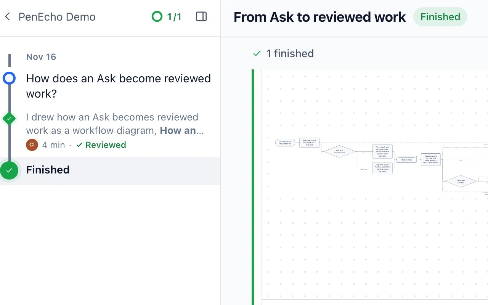
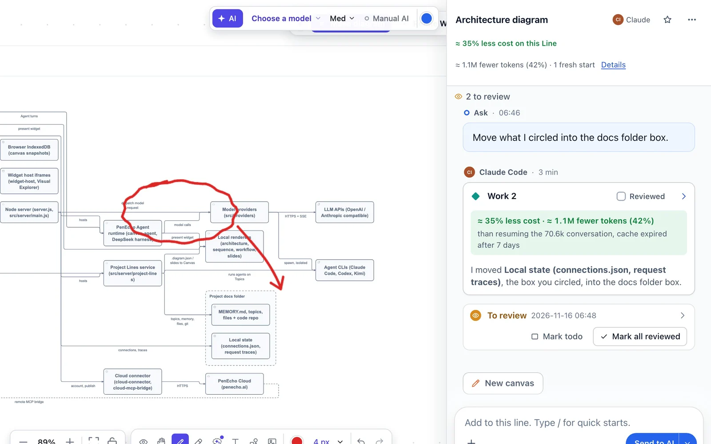

<p align="center">
  <picture>
    <source media="(prefers-color-scheme: dark)" srcset="../../public/penecho-readme-header-dark.webp">
    
  </picture>
</p>

<h1 align="center">No es otro agente de IA. Una mejor forma de trabajar con los tuyos.</h1>

<p align="center">Cada tarea que das a Claude Code, Codex o cualquier agente se convierte en una línea que sigues de un vistazo, desde tu Ask hasta el trabajo revisado.<br>El trabajo largo cuesta más o menos la mitad, y cuando las palabras no bastan, dibujas lo que quieres decir en el Canvas.</p>

<p align="center">
  <a href="https://github.com/penecho/penecho/releases"></a>
  <a href="https://www.npmjs.com/package/penecho"></a>
  <a href="../../LICENSE"></a>
  <a href="https://discord.gg/3jrPJ3mXdX"></a>
  <a href="../mcp-setup.md"></a>
</p>

<p align="center">
  <a href="https://github.com/penecho/penecho/releases"></a>
  <a href="https://github.com/penecho/penecho/releases"></a>
  <a href="https://penecho.ai"></a>
  <a href="https://buymeacoffee.com/penecho"></a>
</p>

<p align="center">
  <a href="#why-work-on-lines">Por qué líneas</a> ·
  <a href="#from-ask-to-reviewed">Cómo funciona</a> ·
  <a href="#hand-over-the-whole-job">Orchestrator</a> ·
  <a href="#quick-start">Inicio rápido</a> ·
  <a href="#connect-your-ai-agent">Conecta tu agente</a> ·
  <a href="#whats-new-in-150">Novedades de 1.5</a> ·
  <a href="#buy-us-a-coffee">Invítanos a un café</a>
</p>

<p align="center">
  <sub><a href="../../README.md">English</a> ·
  <a href="README.zh-CN.md">简体中文</a> ·
  <a href="README.ja.md">日本語</a> ·
  <a href="README.ko.md">한국어</a> ·
  <a href="README.ru.md">Русский</a> ·
  <strong>Español</strong> ·
  <a href="README.pt-BR.md">Português</a> ·
  <a href="README.fr.md">Français</a> ·
  <a href="README.de.md">Deutsch</a></sub>
</p>

<p align="center">
  <a href="https://penecho.ai/lines.html#film"></a>
</p>
<p align="center"><a href="https://penecho.ai/lines.html#film"><strong>▶ Mira PenEcho Lines en 2 minutos</strong></a> · <a href="https://github.com/penecho/penecho/releases/download/v0.1.0/penecho_lines.mp4">Descargar MP4</a></p>

<p align="center"><sub>Código abierto y gratis en tu ordenador. Si PenEcho te ahorra tiempo, <a href="https://buymeacoffee.com/penecho">un café ☕</a> lo mantiene en marcha.</sub></p>

<a name="why-work-on-lines"></a>

## Por qué trabajar en líneas

<p align="center"></p>

<sub>El ahorro se compara con retomar la misma conversación, así que el trabajo largo ahorra más y las tareas cortas, menos.</sub>

<a name="from-ask-to-reviewed"></a>

## De Ask a Revisado

<table width="100%">
  <tr>
    <td width="33%" valign="top">
      <br>
      <strong>1 · Pregunta</strong><br>
      Escribe lo que quieres. Elige un diagrama, un Explorer o diapositivas si quieres la respuesta en imagen.
    </td>
    <td width="33%" valign="top">
      <br>
      <strong>2 · Un agente trabaja</strong><br>
      Ejecútalo con el agente que prefieras. La línea muestra lo que está haciendo y puedes pararlo en cualquier momento.
    </td>
    <td width="33%" valign="top">
      <br>
      <strong>3 · Tú revisas</strong><br>
      El resultado espera como Por revisar. Márcalo como revisado o añade el siguiente Ask en la misma línea.
    </td>
  </tr>
</table>

### Dibuja lo que quieres decir

<table width="100%">
  <tr>
    <td width="50%" valign="top">
      <br>
      <strong>Rodeas una caja</strong> y escribes: «Mueve lo que he rodeado a la caja docs folder».
    </td>
    <td width="50%" valign="top">
      <br>
      <strong>El agente lo ve junto con tus palabras</strong> y mueve esa caja. La línea está al lado del Canvas todo el tiempo.
    </td>
  </tr>
</table>

### Los Topics guardan lo que sabe el proyecto

<p align="center"></p>

Después de cada tarea, el agente archiva lo que aprendió bajo el tema al que pertenece. Un Topic se lee como una sola página: qué se quiere, qué está hecho y qué falta. Cada agente lee la memoria del proyecto antes de empezar.

<a name="hand-over-the-whole-job"></a>

## Entrega el trabajo entero

<p align="center"></p>

Da un trabajo grande a un agente en la pestaña **Orchestrator** de un proyecto. Lo divide, pone al agente adecuado en cada parte, revisa cada resultado frente a tu objetivo e informa una sola vez.

- **El agente adecuado para cada parte:** modelos potentes para las partes difíciles y más baratos para las sencillas, para el mejor resultado por lo que gastas.
- **Aprende quién es bueno en qué:** cada trabajo terminado recibe una puntuación, y esas puntuaciones eligen a los agentes para el siguiente trabajo de ese tipo.
- **Nada oculto:** cada parte es una línea normal que puedes abrir, reorientar o parar, con lo que costó.
- **Los agentes que ya tienes:** Claude Code, Codex, OpenCode, Kimi y más, en tu propio ordenador.

## El Canvas dentro

<table width="100%">
  <tr>
    <td width="33%" valign="top">
      <br>
      <strong>Dibuja y luego pregunta</strong><br>
      Escritura a mano, ecuaciones, texto e imágenes en un lienzo infinito. PenEchoLLM sugiere el siguiente paso cuando haces una pausa.
    </td>
    <td width="33%" valign="top">
      <a href="../assets/professional-diagrams/kubernetes.webp"></a><br>
      <strong>Diagramas profesionales</strong><br>
      Diagramas de arquitectura, de secuencia y de flujo con diseño automático. Exporta a SVG o PNG.
    </td>
    <td width="33%" valign="top">
      <br>
      <strong>Widgets que funcionan</strong><br>
      Calculadoras, cuestionarios y prototipos que se ejecutan en el lienzo y se pueden guardar como favoritos o compartir.
    </td>
  </tr>
</table>

**Nuevo en 1.5: dibujad juntos.** Un clic crea un enlace con el que cualquiera puede dibujar contigo y con tu agente, en directo y sin cuenta. Los enlaces de solo lectura se actualizan mientras trabajas, y cualquier Canvas se descarga como PDF.

<a name="quick-start"></a>

## Inicio rápido

| | Para empezar |
| --- | --- |
| **App de escritorio** | macOS y Windows en [GitHub Releases](https://github.com/penecho/penecho/releases). Lo incluye todo y se actualiza sola. |
| **npm** | Node.js 22.19+. Ejecuta `npm i -g penecho`, después `penecho`, y abre `localhost:3888`. |
| **Navegador** | Inicia sesión en [penecho.ai](https://penecho.ai) para usar modelos alojados y lienzos en la nube. Sin instalar nada. |

```bash
npm install -g penecho
penecho             # abre http://localhost:3888
```

> [!TIP]
> En el primer arranque, elige un código de acceso de seis dígitos (o acceso abierto en una red de confianza). Añade tus agentes y modelos en **Ajustes**: Claude Code, Codex o Kimi con sesión iniciada, tu propia clave de API o los modelos de PenEcho.

<details>
<summary>Ejecutar desde el código fuente</summary>

```bash
git clone https://github.com/penecho/penecho.git
cd penecho
npm install
npm start
```

</details>

<a name="connect-your-ai-agent"></a>

## Conecta tu agente de IA

**En un proyecto,** PenEcho ejecuta los agentes que ya tienes: Claude Code, Codex, OpenCode, Pi, Kimi y más. Añádelos en **Ajustes → Agents** o sigue trabajando en sus propias apps: lo que dicen y cambian aparece solo en la línea.

**Para tener un Canvas junto a cualquier chat,** pega una línea en Claude Code, Codex, Cursor u otro agente MCP:

```text
Set up PenEcho for me by following https://penecho.ai/agents.md
```

Después, solo pide:

- *«Dibuja la arquitectura de este proyecto en el lienzo».*
- *«Convierte nuestro flujo de inicio de sesión en un diagrama de secuencia en el lienzo».*
- *«Lee mis notas a mano del lienzo y revisa el diagrama».*

El Canvas se abre junto a tu chat. No hace falta cuenta; si te lo pregunta, elige **Continuar como invitado**. MCP no usa créditos de PenEcho.

<details>
<summary>MCP local para una instalación global con npm</summary>

Activa MCP en **Ajustes → MCP** y usa **Configurar automáticamente**, o añade esta entrada a un cliente que acepte JSON `mcpServers`:

```json
{
  "mcpServers": {
    "penecho": { "command": "penecho", "args": ["mcp"] }
  }
}
```

Los agentes solo ven los lienzos que actives. El MCP local se queda en tu ordenador; el MCP en la nube usa una autorización OAuth aparte. [Guía de MCP →](../mcp-setup.md) · [Instalación del plugin](../../integrations/penecho-cloud/INSTALL.md)

</details>

<details>
<summary>Galería de diagramas</summary>

<table width="100%">
  <tr>
    <td width="33%" valign="top"><a href="../assets/professional-diagrams/kubernetes.webp"></a><br><strong>Kubernetes cluster</strong></td>
    <td width="33%" valign="top"><a href="../assets/professional-diagrams/migration.webp"></a><br><strong>Monolith → microservices</strong></td>
    <td width="33%" valign="top"><a href="../assets/professional-diagrams/notifications.webp"></a><br><strong>Event-driven notifications</strong></td>
  </tr>
  <tr>
    <td valign="top"><a href="../assets/professional-diagrams/mcp-request.webp"></a><br><strong>How MCP reaches the canvas</strong></td>
    <td valign="top"><a href="../assets/professional-diagrams/release.webp"></a><br><strong>Release: parallel tasks</strong></td>
    <td valign="top"><a href="../assets/professional-diagrams/rollout.webp"></a><br><strong>Multi-region rollout</strong></td>
  </tr>
</table>

<p align="center"><sub>Haz clic en cualquier diagrama para verlo a tamaño completo.</sub></p>

</details>

## Cómo funciona

<p align="center"></p>

- **En tu ordenador** — la app de escritorio o la CLI sirve el lienzo y usa tu propia API de modelos o la CLI de tu agente.
- **En la nube** — penecho.ai añade modelos alojados, proyectos sincronizados y compartidos, y enlaces en directo para dibujar juntos.
- **Tu agente** — se conecta mediante MCP local o en la nube. Ambos son opcionales.

Detalles: [notas de arquitectura](../architecture.md).

## Elige tu IA

| Conexión | Coste | Ideal para |
| --- | --- | --- |
| **Modelos de PenEcho** — inicia sesión y elige un modelo | Créditos de la cuenta | Empezar sin claves |
| **Tu API de modelos** — compatible con OpenAI o Anthropic | Tu proveedor | Control total del modelo y del coste |
| **Tu CLI** — Codex, Claude Code o Kimi con sesión iniciada | Tu plan | Aprovechar una suscripción que ya tienes |

Qué modelo y nivel de razonamiento elegir: [modelos recomendados](#recommended-models) (se actualizan en cada versión).

<a name="recommended-models"></a>
<details>
<summary>Modelos recomendados</summary>

Estas recomendaciones equilibran la calidad de las respuestas con la latencia del trabajo real de PenEcho en el lienzo, según las pruebas prácticas actuales; el tiempo real de respuesta varía con el proveedor, la complejidad del lienzo y el razonamiento.

| Modelo | Nivel | Notas | Uso recomendado |
| --- | --- | --- | --- |
| Claude Opus 4.8 / 5.0 (`claude-opus-4-8` / `claude-opus-5-0`) | `medium` | Gran calidad con un mejor equilibrio de latencia | Trabajo diario en el lienzo |
| Claude Opus 4.8 / 5.0 (`claude-opus-4-8` / `claude-opus-5-0`) | `high` | Mayor calidad de razonamiento, esperas más largas y variables | Escritura a mano compleja, matemáticas, diagramas o maquetación |
| Fable 5 (`claude-fable-5` or `fable`) | `medium` | A menudo, alrededor de la mitad del tiempo de respuesta de `gpt-5.6-sol` en `xhigh` | Uso general rápido y de calidad |
| [Kimi K3](https://platform.kimi.ai?aff=penecho) (`kimi-k3`) | `medium` | Muy buena calidad; `medium` mantiene un equilibrio práctico | Ajuste recomendado para Kimi |
| `gpt-5.6-terra` | de `low` a `high` | Sorprendentemente potente y ágil | Objetivos flexibles de calidad y latencia |
| `gpt-5.6-luna` | `xhigh` | Muy buenos resultados en el lienzo con gran velocidad | Primero la calidad, sin perder agilidad |
| `gpt-5.6-sol` | `high` | Suficiente para la mayoría de peticiones, más ágil que `xhigh` | Por defecto cuando importa la rapidez |
| `gpt-5.6-sol` | `xhigh` | Muy bueno, pero más lento y variable | Tareas difíciles en el lienzo |
| `deepseek-v4-flash-vision-exp` | `medium` | Bueno | Trabajo con visión mediante la API de DeepSeek |
| `glm-5.3-flash` | `medium` | Bueno | Trabajo rápido mediante la API compatible con Anthropic de GLM |

</details>

<a name="whats-new-in-150"></a>

## Novedades de 1.5.0

- **PenEcho Lines:** cada tarea es una línea, desde tu Ask hasta el trabajo revisado, con Topics, ahorro de tokens y cualquier agente en la misma línea.
- **Colaborar:** un clic crea un enlace con el que cualquiera puede dibujar contigo, en directo y sin cuenta.
- **Compartir y PDF:** los enlaces de solo lectura se actualizan en directo mientras trabajas, y cualquier Canvas se descarga como PDF.
- **Proyectos de carpeta:** los agentes de IA que trabajan en una misma carpeta comparten una página; sus lienzos son pestañas y cada uno se guarda solo.
- **Configurar un agente en una línea:** «Set up PenEcho for me by following https://penecho.ai/agents.md».

[Registro de cambios completo →](../../CHANGELOG.md#150)

<a name="buy-us-a-coffee"></a>
<a name="support-penecho"></a>

## Invítanos a un café

<p align="center">
  <a href="https://buymeacoffee.com/penecho"></a>
</p>

PenEcho es gratis en tu ordenador y sin cuenta. Si te ahorró una tarde, o unos cuantos millones de tokens, un café es la forma más rápida de dar las gracias, y va directo al desarrollo, las pruebas y la documentación.

<p align="center">
  <a href="https://buymeacoffee.com/penecho"></a>
  <a href="https://github.com/sponsors/penecho"></a>
</p>

¿No te sobra dinero? Una ⭐ en este repositorio, un informe de error o contárselo a un amigo ayuda igual.

<sub>Las aportaciones apoyan el mantenimiento del código abierto; no compran una licencia comercial, soporte dedicado ni funciones garantizadas.</sub>

## Comunidad

| [Discord](https://discord.gg/3jrPJ3mXdX) | [Discussions](https://github.com/penecho/penecho/discussions) | [Issues](https://github.com/penecho/penecho/issues) | [Contributing](../../CONTRIBUTING.md) |
| --- | --- | --- | --- |
| Habla con el equipo | Ideas y preguntas | Informa de un error | Ejecuta antes `npm run check` |

Con licencia [AGPL-3.0-only](../../LICENSE); hay [licencia comercial](../../COMMERCIAL-LICENSE.md) disponible. [Política de marcas](../../TRADEMARKS.md) · [Acuerdo de colaborador](../../CONTRIBUTOR-LICENSE-AGREEMENT.md).

Los renderizadores de diagramas adaptan utilidades de SVG y geometría de [Archify](https://github.com/tt-a1i/archify), de tt-a1i (MIT). Consulta [NOTICE](../../NOTICE).

<p align="center">
  <a href="https://www.kimi.com/code?aff=penecho">
    <picture>
      <source media="(prefers-color-scheme: dark)" srcset="../assets/kimi-open-source-friends-dark.svg">
      
    </picture>
  </a>
</p>

<p align="center">
  <a href="https://www.star-history.com/?repos=penecho%2Fpenecho&amp;type=date&amp;legend=top-left">
    <picture>
      <source media="(prefers-color-scheme: dark)" srcset="https://api.star-history.com/chart?repos=penecho/penecho&amp;type=date&amp;theme=dark&amp;legend=top-left">
      
    </picture>
  </a>
</p>
