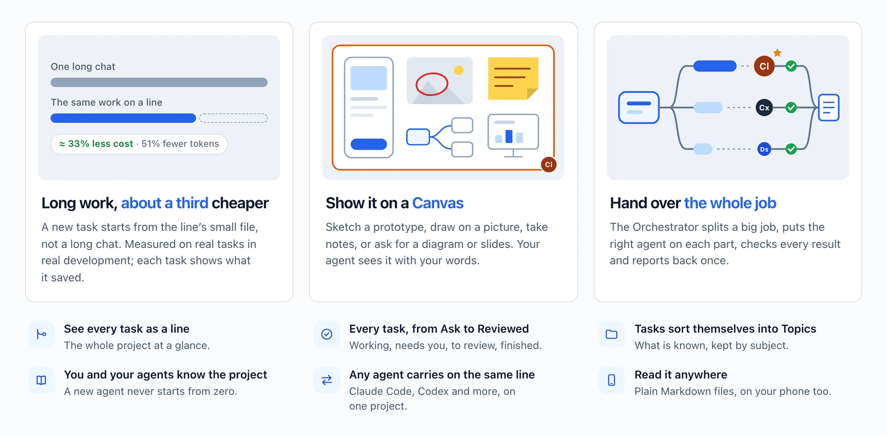
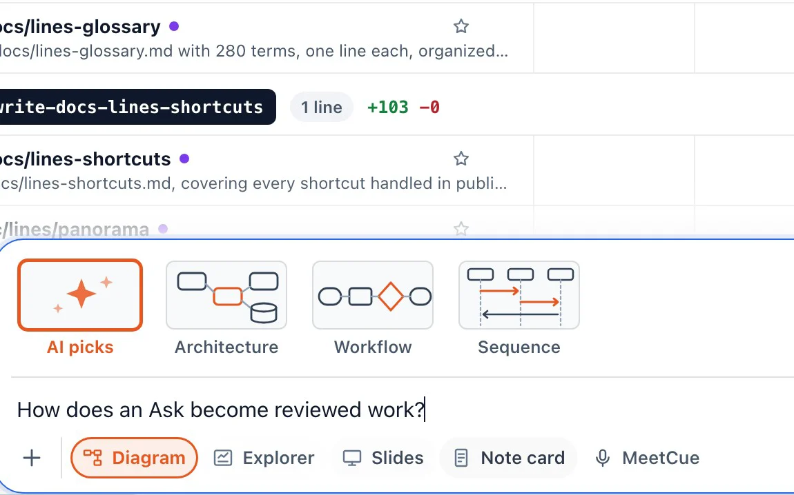

<p align="center">
  <picture>
    <source media="(prefers-color-scheme: dark)" srcset="../../public/penecho-readme-header-dark.webp">
    
  </picture>
</p>

<h1 align="center">また新しい AI エージェントではない。あなたのエージェントと働く、より良い方法。</h1>

<p align="center">Claude Code や Codex、どんな Agent に頼んだタスクも、ひと目で追える一本のラインになります。あなたの Ask からレビュー済みの成果まで。<br>長い作業のコストはおよそ半分。言葉で伝えにくいときは、Canvas に描いて伝えられます。</p>

<p align="center">
  <a href="https://github.com/penecho/penecho/releases"></a>
  <a href="https://www.npmjs.com/package/penecho"></a>
  <a href="../../LICENSE"></a>
  <a href="https://discord.gg/3jrPJ3mXdX"></a>
  <a href="../mcp-setup.md"></a>
</p>

<p align="center">
  <a href="https://github.com/penecho/penecho/releases"></a>
  <a href="https://github.com/penecho/penecho/releases"></a>
  <a href="https://penecho.ai"></a>
  <a href="https://buymeacoffee.com/penecho"></a>
</p>

<p align="center">
  <a href="#why-work-on-lines">ラインを使う理由</a> ·
  <a href="#from-ask-to-reviewed">使い方</a> ·
  <a href="#hand-over-the-whole-job">Orchestrator</a> ·
  <a href="#quick-start">クイックスタート</a> ·
  <a href="#connect-your-ai-agent">Agent をつなぐ</a> ·
  <a href="#whats-new-in-150">1.5 の新機能</a> ·
  <a href="#buy-us-a-coffee">コーヒーをおごる</a>
</p>

<p align="center">
  <sub><a href="../../README.md">English</a> ·
  <a href="README.zh-CN.md">简体中文</a> ·
  <strong>日本語</strong> ·
  <a href="README.ko.md">한국어</a> ·
  <a href="README.ru.md">Русский</a> ·
  <a href="README.es.md">Español</a> ·
  <a href="README.pt-BR.md">Português</a> ·
  <a href="README.fr.md">Français</a> ·
  <a href="README.de.md">Deutsch</a></sub>
</p>

<p align="center">
  <a href="https://penecho.ai/lines.html#film"></a>
</p>
<p align="center"><a href="https://penecho.ai/lines.html#film"><strong>▶ 2 分で PenEcho Lines を見る</strong></a> · <a href="https://github.com/penecho/penecho/releases/download/v0.1.0/penecho_lines.mp4">MP4 をダウンロード</a></p>

<p align="center"><sub>オープンソースで、あなたのコンピューターでは無料です。PenEcho で時間が浮いたら、<a href="https://buymeacoffee.com/penecho">コーヒー 1 杯 ☕</a> が開発を支えます。</sub></p>

<a name="why-work-on-lines"></a>

## ラインで働く理由

<p align="center"></p>

<sub>節約量は同じ会話を再開した場合との比較です。長い作業ほど多く節約でき、短いタスクでは少なくなります。</sub>

<a name="from-ask-to-reviewed"></a>

## Ask からレビュー済みまで

<table width="100%">
  <tr>
    <td width="33%" valign="top">
      <br>
      <strong>1 · Ask する</strong><br>
      やりたいことを書きます。絵で答えがほしいときは、図、Explorer、スライドを選びます。
    </td>
    <td width="33%" valign="top">
      <br>
      <strong>2 · Agent が作業する</strong><br>
      好きな Agent で実行します。ラインには今やっていることが表示され、いつでも止められます。
    </td>
    <td width="33%" valign="top">
      <br>
      <strong>3 · あなたがレビューする</strong><br>
      結果は「レビュー待ち」で待っています。レビュー済みにするか、同じラインに次の Ask を足します。
    </td>
  </tr>
</table>

### 伝えたいことを描く

<table width="100%">
  <tr>
    <td width="50%" valign="top">
      <br>
      <strong>箱を丸で囲んで</strong>、こう書きます：「囲んだものを docs folder の箱に移して。」
    </td>
    <td width="50%" valign="top">
      <br>
      <strong>Agent はあなたの言葉と一緒にそれを見て</strong>、その箱を移します。ラインはずっと Canvas の横にあります。
    </td>
  </tr>
</table>

### Topic がプロジェクトの知識を保つ

<p align="center"></p>

タスクが終わるたびに、Agent は学んだことを該当するテーマの下に整理します。Topic は 1 ページで読めます。何が求められ、何が済み、何が残っているか。どの Agent も作業前にプロジェクトのメモリを読みます。

<a name="hand-over-the-whole-job"></a>

## 仕事をまるごと任せる

<p align="center"></p>

プロジェクトの **Orchestrator** タブで、ひとつの Agent に大きな仕事を渡します。仕事を分け、各部分に合った Agent を割り当て、あなたの目標に照らしてすべての結果を確認し、一度だけ報告します。

- **各部分に合った Agent：** 難しい部分には強いモデル、簡単な部分には安いモデル。かけた費用で最良の結果を。
- **誰が何に強いかを学ぶ：** 終わった仕事はすべて評価され、そのスコアで次の同じ種類の仕事の Agent が選ばれます。
- **隠しごとなし：** 各部分は普通のラインで、開く・方向を変える・止めることができ、かかった費用も見えます。
- **手持ちの Agent で：** Claude Code、Codex、OpenCode、Kimi など。すべてあなたのコンピューター上で。

## 中にある Canvas

<table width="100%">
  <tr>
    <td width="33%" valign="top">
      <br>
      <strong>描いてから、聞く</strong><br>
      無限の Canvas に手書き、数式、テキスト、画像。手を止めると PenEchoLLM が次の一手を提案します。
    </td>
    <td width="33%" valign="top">
      <a href="../assets/professional-diagrams/kubernetes.webp"></a><br>
      <strong>プロ品質の図</strong><br>
      アーキテクチャ図、シーケンス図、ワークフロー図を自動レイアウトで。SVG や PNG で書き出せます。
    </td>
    <td width="33%" valign="top">
      <br>
      <strong>動くウィジェット</strong><br>
      電卓、クイズ、プロトタイプが Canvas 上で動き、お気に入りや共有もできます。
    </td>
  </tr>
</table>

**1.5 の新機能：一緒に描く。** ワンクリックでリンクを作れば、誰でもアカウントなしで、あなたとあなたの Agent とリアルタイムに描けます。閲覧専用リンクは作業に合わせて更新され、どの Canvas も PDF でダウンロードできます。

<a name="quick-start"></a>

## クイックスタート

| | はじめ方 |
| --- | --- |
| **デスクトップアプリ** | macOS と Windows は [GitHub Releases](https://github.com/penecho/penecho/releases) から。すべて入っていて、自動で更新されます。 |
| **npm** | Node.js 22.19+。`npm i -g penecho` を実行し、`penecho` を実行して `localhost:3888` を開きます。 |
| **ブラウザー** | [penecho.ai](https://penecho.ai) にサインインすると、ホストされたモデルとクラウドの Canvas が使えます。インストール不要。 |

```bash
npm install -g penecho
penecho             # http://localhost:3888 を開きます
```

> [!TIP]
> 初回起動時に 6 桁のアクセスコードを決めます（信頼できるネットワークではオープンアクセスも可）。**設定** で Agent とモデルを追加します：サインイン済みの Claude Code、Codex、Kimi、あなたの API キー、または PenEcho モデル。

<details>
<summary>ソースから実行</summary>

```bash
git clone https://github.com/penecho/penecho.git
cd penecho
npm install
npm start
```

</details>

<a name="connect-your-ai-agent"></a>

## AI Agent をつなぐ

**プロジェクトでは、** PenEcho が手持ちの Agent を動かします：Claude Code、Codex、OpenCode、Pi、Kimi など。**設定 → Agents** で追加するか、それぞれのアプリで作業を続けてください。話したことや変えたことは、自動でラインに表示されます。

**どのチャットの横にも Canvas を開くには、** Claude Code、Codex、Cursor など MCP 対応の Agent に次の 1 行を貼り付けます：

```text
Set up PenEcho for me by following https://penecho.ai/agents.md
```

あとは頼むだけです：

- *「このプロジェクトのアーキテクチャを Canvas に描いて。」*
- *「ログインの流れを Canvas 上のシーケンス図にして。」*
- *「Canvas の手書きメモを読んで、図を直して。」*

Canvas はチャットの横に開きます。アカウントは不要です。聞かれたら **ゲストとして続ける** を選んでください。MCP は PenEcho のクレジットを使いません。

<details>
<summary>npm グローバルインストール用のローカル MCP</summary>

**設定 → MCP** で MCP をオンにして **自動設定** を使うか、`mcpServers` JSON を受け付けるクライアントに次の項目を追加します：

```json
{
  "mcpServers": {
    "penecho": { "command": "penecho", "args": ["mcp"] }
  }
}
```

Agent に見えるのは、あなたがオンにした Canvas だけです。ローカル MCP はあなたのコンピューターの中だけ。クラウド MCP は別の OAuth 認可を使います。[MCP ガイド →](../mcp-setup.md) · [プラグインのインストール](../../integrations/penecho-cloud/INSTALL.md)

</details>

<details>
<summary>図のギャラリー</summary>

<table width="100%">
  <tr>
    <td width="33%" valign="top"><a href="../assets/professional-diagrams/kubernetes.webp"></a><br><strong>Kubernetes cluster</strong></td>
    <td width="33%" valign="top"><a href="../assets/professional-diagrams/migration.webp"></a><br><strong>Monolith → microservices</strong></td>
    <td width="33%" valign="top"><a href="../assets/professional-diagrams/notifications.webp"></a><br><strong>Event-driven notifications</strong></td>
  </tr>
  <tr>
    <td valign="top"><a href="../assets/professional-diagrams/mcp-request.webp"></a><br><strong>How MCP reaches the canvas</strong></td>
    <td valign="top"><a href="../assets/professional-diagrams/release.webp"></a><br><strong>Release: parallel tasks</strong></td>
    <td valign="top"><a href="../assets/professional-diagrams/rollout.webp"></a><br><strong>Multi-region rollout</strong></td>
  </tr>
</table>

<p align="center"><sub>図をクリックすると原寸で表示されます。</sub></p>

</details>

## しくみ

<p align="center"></p>

- **あなたのコンピューターで** — デスクトップアプリか CLI が Canvas を提供し、あなたのモデル API や Agent の CLI を使います。
- **クラウドで** — penecho.ai がホストされたモデル、同期・共有されるプロジェクト、一緒に描くためのライブリンクを加えます。
- **あなたの Agent** — ローカルまたはクラウドの MCP でつながります。どちらも任意です。

詳しくは：[アーキテクチャのメモ](../architecture.md)。

## AI を選ぶ

| 接続方法 | 費用 | 向いている用途 |
| --- | --- | --- |
| **PenEcho モデル** — サインインしてモデルを選ぶ | アカウントのクレジット | すぐ始めたい、キーなし |
| **あなたのモデル API** — OpenAI 互換または Anthropic 互換 | あなたのプロバイダー | モデルと費用を完全に管理 |
| **あなたの CLI** — サインイン済みの Codex、Claude Code、Kimi | あなたのプラン | 手持ちのサブスクリプションを活用 |

どのモデルと推論レベルを選ぶか：[おすすめのモデル](#recommended-models)（リリースごとに更新）。

<a name="recommended-models"></a>
<details>
<summary>おすすめのモデル</summary>

これらのおすすめは、現在の実地テストにもとづき、回答の質と PenEcho の実際の Canvas 作業での待ち時間のバランスをとったものです。実際の応答時間はプロバイダー、Canvas の複雑さ、推論の挙動によって変わります。

| モデル | 推論レベル | メモ | おすすめの用途 |
| --- | --- | --- | --- |
| Claude Opus 4.8 / 5.0 (`claude-opus-4-8` / `claude-opus-5-0`) | `medium` | 質が高く、待ち時間とのバランスが良い | 日々の Canvas 作業 |
| Claude Opus 4.8 / 5.0 (`claude-opus-4-8` / `claude-opus-5-0`) | `high` | 推論の質はさらに高いが、待ち時間が長くばらつく | 複雑な手書き、数学、図、レイアウト |
| Fable 5 (`claude-fable-5` or `fable`) | `medium` | 応答時間は `xhigh` の `gpt-5.6-sol` のおよそ半分のことが多い | 速く高品質な普段使い |
| [Kimi K3](https://platform.kimi.ai?aff=penecho) (`kimi-k3`) | `medium` | とても良い質。`medium` でバランスが実用的 | Kimi のおすすめ既定値 |
| `gpt-5.6-terra` | `low` から `high` | 意外なほど強く、反応が速い | 質と待ち時間を柔軟に調整 |
| `gpt-5.6-luna` | `xhigh` | Canvas での結果がとても良く、速い | 質優先でも反応は良い |
| `gpt-5.6-sol` | `high` | ほとんどの依頼に十分で、`xhigh` より速い | 反応の速さを重視するときの既定 |
| `gpt-5.6-sol` | `xhigh` | とても良いが、遅くばらつきが大きい | 難しい Canvas 作業 |
| `deepseek-v4-flash-vision-exp` | `medium` | 良い | DeepSeek API を通した画像を扱う作業 |
| `glm-5.3-flash` | `medium` | 良い | GLM の Anthropic 互換 API を通した速い作業 |

</details>

<a name="whats-new-in-150"></a>

## 1.5.0 の新機能

- **PenEcho Lines：** すべてのタスクが、あなたの Ask からレビュー済みまでのラインに。Topic、トークンの節約、どの Agent も同じラインを引き継げます。
- **一緒に描く：** ワンクリックでリンクを作れば、誰でもアカウントなしでリアルタイムに一緒に描けます。
- **共有と PDF：** 閲覧専用リンクは作業に合わせてリアルタイムに更新され、どの Canvas も PDF でダウンロードできます。
- **フォルダープロジェクト：** 同じフォルダーで作業する AI Agent はひとつのページを共有します。その Canvas はタブになり、それぞれ自動で保存されます。
- **1 行で Agent をセットアップ：** 「Set up PenEcho for me by following https://penecho.ai/agents.md」。

[変更履歴をすべて見る →](../../CHANGELOG.md#150)

<a name="buy-us-a-coffee"></a>
<a name="support-penecho"></a>

## コーヒーをおごってください

<p align="center">
  <a href="https://buymeacoffee.com/penecho"></a>
</p>

PenEcho はあなたのコンピューターで無料、アカウントも不要です。午後ひとつ分、あるいは数百万トークン分の節約になったなら、コーヒー 1 杯がいちばん手早いお礼です。開発、テスト、ドキュメントにそのまま使われます。

<p align="center">
  <a href="https://buymeacoffee.com/penecho"></a>
  <a href="https://github.com/sponsors/penecho"></a>
</p>

余裕がなくても大丈夫。このリポジトリへの ⭐、バグ報告、友だちに教えることも同じくらい助けになります。

<sub>寄付はオープンソースの保守を支えるものであり、商用ライセンス、専用サポート、機能の保証を購入するものではありません。</sub>

## コミュニティ

| [Discord](https://discord.gg/3jrPJ3mXdX) | [Discussions](https://github.com/penecho/penecho/discussions) | [Issues](https://github.com/penecho/penecho/issues) | [Contributing](../../CONTRIBUTING.md) |
| --- | --- | --- | --- |
| チームと話す | アイデアと質問 | バグを報告 | 先に `npm run check` を実行 |

ライセンスは [AGPL-3.0-only](../../LICENSE)。[商用ライセンス](../../COMMERCIAL-LICENSE.md) もあります。[商標ポリシー](../../TRADEMARKS.md) · [コントリビューター契約](../../CONTRIBUTOR-LICENSE-AGREEMENT.md)。

図のレンダラーは tt-a1i による [Archify](https://github.com/tt-a1i/archify)（MIT）の SVG とジオメトリのヘルパーを改変して使っています。[NOTICE](../../NOTICE) を参照してください。

<p align="center">
  <a href="https://www.kimi.com/code?aff=penecho">
    <picture>
      <source media="(prefers-color-scheme: dark)" srcset="../assets/kimi-open-source-friends-dark.svg">
      
    </picture>
  </a>
</p>

<p align="center">
  <a href="https://www.star-history.com/?repos=penecho%2Fpenecho&amp;type=date&amp;legend=top-left">
    <picture>
      <source media="(prefers-color-scheme: dark)" srcset="https://api.star-history.com/chart?repos=penecho/penecho&amp;type=date&amp;theme=dark&amp;legend=top-left">
      
    </picture>
  </a>
</p>
