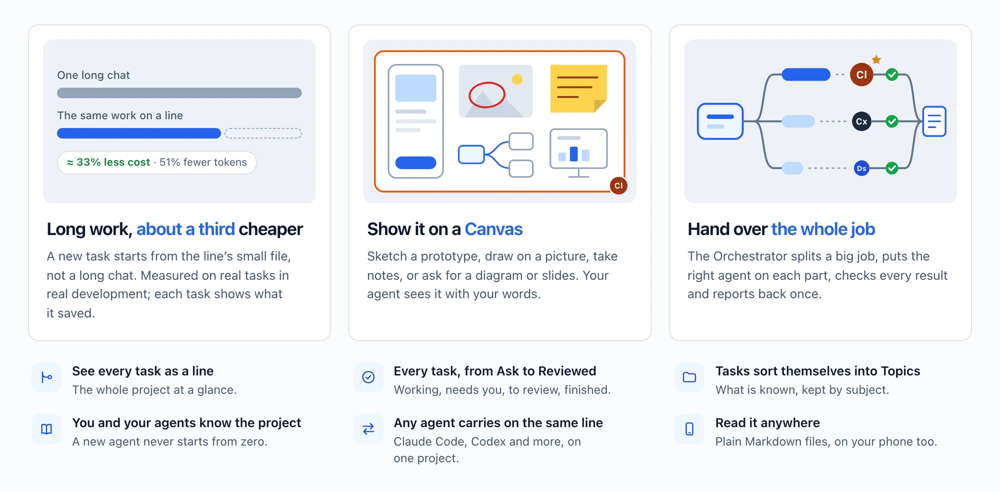
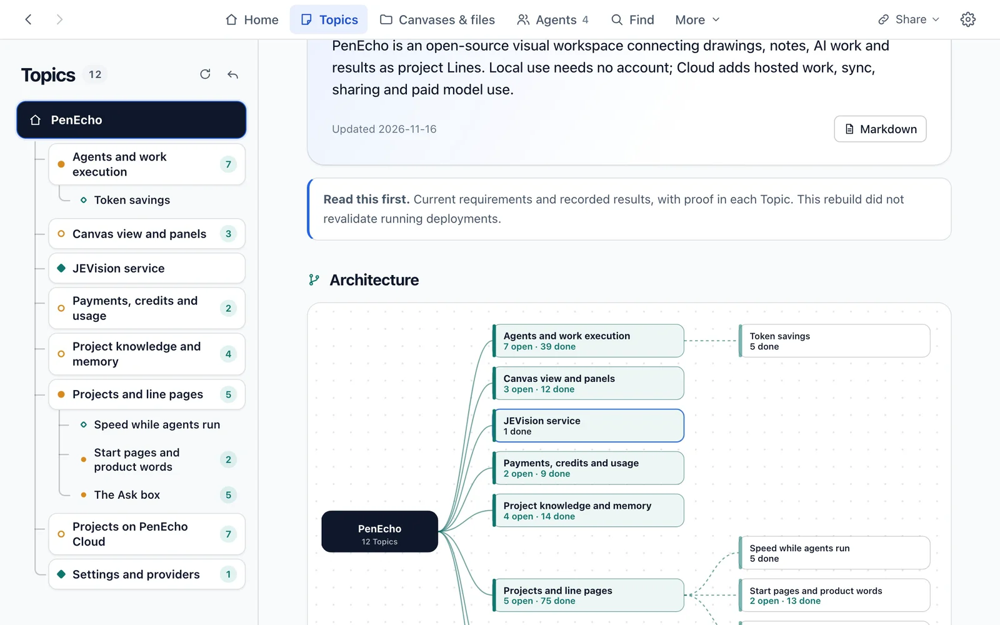
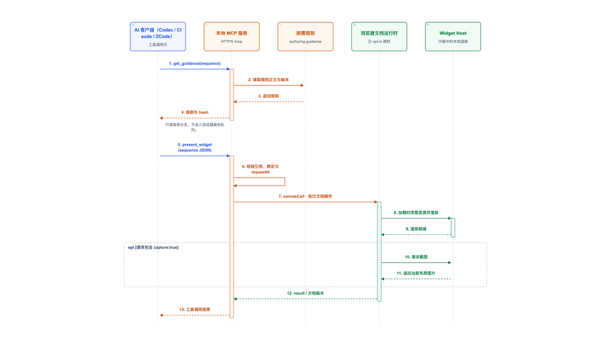

<p align="center">
  <picture>
    <source media="(prefers-color-scheme: dark)" srcset="../../public/penecho-readme-header-dark.webp">
    
  </picture>
</p>

<h1 align="center">또 하나의 AI 에이전트가 아닙니다. 당신의 에이전트와 일하는 더 나은 방법.</h1>

<p align="center">Claude Code, Codex 등 어떤 Agent에게 맡긴 작업이든 한눈에 따라갈 수 있는 하나의 라인이 됩니다. 당신의 Ask부터 검토가 끝난 결과까지.<br>긴 작업의 비용은 약 절반, 말로 부족할 때는 Canvas에 뜻을 그려 보여 주세요.</p>

<p align="center">
  <a href="https://github.com/penecho/penecho/releases"></a>
  <a href="https://www.npmjs.com/package/penecho"></a>
  <a href="../../LICENSE"></a>
  <a href="https://discord.gg/3jrPJ3mXdX"></a>
  <a href="../mcp-setup.md"></a>
</p>

<p align="center">
  <a href="https://github.com/penecho/penecho/releases"></a>
  <a href="https://github.com/penecho/penecho/releases"></a>
  <a href="https://penecho.ai"></a>
  <a href="https://buymeacoffee.com/penecho"></a>
</p>

<p align="center">
  <a href="#why-work-on-lines">왜 라인인가</a> ·
  <a href="#from-ask-to-reviewed">사용 방법</a> ·
  <a href="#hand-over-the-whole-job">Orchestrator</a> ·
  <a href="#quick-start">빠른 시작</a> ·
  <a href="#connect-your-ai-agent">Agent 연결</a> ·
  <a href="#whats-new-in-150">1.5의 새 기능</a> ·
  <a href="#buy-us-a-coffee">커피 한 잔 사 주기</a>
</p>

<p align="center">
  <sub><a href="../../README.md">English</a> ·
  <a href="README.zh-CN.md">简体中文</a> ·
  <a href="README.ja.md">日本語</a> ·
  <strong>한국어</strong> ·
  <a href="README.ru.md">Русский</a> ·
  <a href="README.es.md">Español</a> ·
  <a href="README.pt-BR.md">Português</a> ·
  <a href="README.fr.md">Français</a> ·
  <a href="README.de.md">Deutsch</a></sub>
</p>

<p align="center">
  <a href="https://penecho.ai/lines.html#film"></a>
</p>
<p align="center"><a href="https://penecho.ai/lines.html#film"><strong>▶ 2분 만에 PenEcho Lines 보기</strong></a> · <a href="https://github.com/penecho/penecho/releases/download/v0.1.0/penecho_lines.mp4">MP4 다운로드</a></p>

<p align="center"><sub>오픈 소스이며 당신의 컴퓨터에서는 무료입니다. PenEcho로 시간을 아꼈다면 <a href="https://buymeacoffee.com/penecho">커피 한 잔 ☕</a>이 개발을 이어 가게 합니다.</sub></p>

<a name="why-work-on-lines"></a>

## 왜 라인에서 일할까요

<p align="center"></p>

<sub>절약량은 같은 대화를 이어 갔을 때와 비교한 값입니다. 긴 작업일수록 많이 아끼고, 짧은 작업은 덜 아낍니다.</sub>

<a name="from-ask-to-reviewed"></a>

## Ask부터 검토 완료까지

<table width="100%">
  <tr>
    <td width="33%" valign="top">
      <br>
      <strong>1 · Ask</strong><br>
      원하는 것을 적으세요. 그림으로 답을 받고 싶다면 다이어그램, Explorer, 슬라이드를 고르세요.
    </td>
    <td width="33%" valign="top">
      <br>
      <strong>2 · Agent가 일합니다</strong><br>
      원하는 Agent로 실행하세요. 라인에 지금 하는 일이 보이고, 언제든 멈출 수 있습니다.
    </td>
    <td width="33%" valign="top">
      <br>
      <strong>3 · 당신이 검토합니다</strong><br>
      결과는 '검토 대기'로 기다립니다. 검토 완료로 표시하거나 같은 라인에 다음 Ask를 더하세요.
    </td>
  </tr>
</table>

### 뜻을 그려서 전하기

<table width="100%">
  <tr>
    <td width="50%" valign="top">
      <br>
      <strong>상자에 동그라미를 치고</strong> 이렇게 씁니다: “동그라미 친 것을 docs folder 상자로 옮겨 줘.”
    </td>
    <td width="50%" valign="top">
      <br>
      <strong>Agent는 당신의 말과 함께 그것을 보고</strong> 그 상자를 옮깁니다. 라인은 내내 Canvas 옆에 있습니다.
    </td>
  </tr>
</table>

### Topic이 프로젝트가 아는 것을 지킵니다

<p align="center"></p>

작업이 끝날 때마다 Agent는 배운 것을 해당 주제 아래에 정리합니다. Topic은 한 페이지로 읽힙니다. 무엇을 원했고, 무엇을 했고, 무엇이 남았는지. 모든 Agent는 시작하기 전에 프로젝트 메모리를 읽습니다.

<a name="hand-over-the-whole-job"></a>

## 일 전체를 맡기세요

<p align="center"></p>

프로젝트의 **Orchestrator** 탭에서 한 Agent에게 큰 일을 맡기세요. 일을 나누고, 각 부분에 맞는 Agent를 배정하고, 당신의 목표에 비추어 모든 결과를 확인한 뒤 한 번에 보고합니다.

- **부분마다 맞는 Agent:** 어려운 부분에는 강한 모델, 쉬운 부분에는 저렴한 모델. 쓴 비용 대비 최고의 결과를.
- **누가 무엇을 잘하는지 배웁니다:** 끝난 일은 모두 평가되고, 그 점수로 다음 같은 종류의 일을 맡을 Agent를 고릅니다.
- **숨김 없음:** 각 부분은 평범한 라인이라 열고, 방향을 바꾸고, 멈출 수 있으며 비용도 보입니다.
- **이미 가진 Agent로:** Claude Code, Codex, OpenCode, Kimi 등, 모두 당신의 컴퓨터에서.

## 안에 있는 Canvas

<table width="100%">
  <tr>
    <td width="33%" valign="top">
      <br>
      <strong>그리고, 물어보세요</strong><br>
      끝없는 Canvas에 손글씨, 수식, 텍스트, 이미지. 잠시 멈추면 PenEchoLLM이 다음 단계를 제안합니다.
    </td>
    <td width="33%" valign="top">
      <a href="../assets/professional-diagrams/kubernetes.webp"></a><br>
      <strong>전문적인 다이어그램</strong><br>
      아키텍처, 시퀀스, 워크플로 다이어그램을 자동 배치로. SVG나 PNG로 내보낼 수 있습니다.
    </td>
    <td width="33%" valign="top">
      <br>
      <strong>동작하는 위젯</strong><br>
      계산기, 퀴즈, 프로토타입이 Canvas에서 실행되며 즐겨찾기하거나 공유할 수 있습니다.
    </td>
  </tr>
</table>

**1.5의 새 기능: 함께 그리기.** 한 번 클릭으로 링크를 만들면 누구나 계정 없이 당신, 당신의 Agent와 실시간으로 그릴 수 있습니다. 보기 전용 링크는 작업에 맞춰 갱신되고, 어떤 Canvas든 PDF로 내려받을 수 있습니다.

<a name="quick-start"></a>

## 빠른 시작

| | 시작하기 |
| --- | --- |
| **데스크톱 앱** | macOS와 Windows는 [GitHub Releases](https://github.com/penecho/penecho/releases)에서. 모든 것이 들어 있고 스스로 업데이트됩니다. |
| **npm** | Node.js 22.19+. `npm i -g penecho`를 실행한 뒤 `penecho`를 실행하고 `localhost:3888`을 여세요. |
| **브라우저** | [penecho.ai](https://penecho.ai)에 로그인하면 호스팅 모델과 클라우드 Canvas를 쓸 수 있습니다. 설치가 필요 없습니다. |

```bash
npm install -g penecho
penecho             # http://localhost:3888 을 엽니다
```

> [!TIP]
> 처음 시작할 때 여섯 자리 접근 코드를 정하세요(신뢰할 수 있는 네트워크라면 열린 접근도 가능). **설정**에서 Agent와 모델을 추가하세요: 로그인한 Claude Code, Codex, Kimi, 당신의 API 키, 또는 PenEcho 모델.

<details>
<summary>소스에서 실행</summary>

```bash
git clone https://github.com/penecho/penecho.git
cd penecho
npm install
npm start
```

</details>

<a name="connect-your-ai-agent"></a>

## AI Agent 연결

**프로젝트에서는** PenEcho가 이미 가진 Agent를 실행합니다: Claude Code, Codex, OpenCode, Pi, Kimi 등. **설정 → Agents**에서 추가하거나, 각자의 앱에서 계속 작업하세요. 그들이 말하고 바꾼 내용이 라인에 저절로 나타납니다.

**어떤 대화 옆에든 Canvas를 열려면** Claude Code, Codex, Cursor 등 MCP Agent에 이 한 줄을 붙여 넣으세요:

```text
Set up PenEcho for me by following https://penecho.ai/agents.md
```

그다음 이렇게 말하면 됩니다:

- *“이 프로젝트의 아키텍처를 Canvas에 그려 줘.”*
- *“우리 로그인 흐름을 Canvas 위의 시퀀스 다이어그램으로 만들어 줘.”*
- *“Canvas에 있는 내 손글씨 메모를 읽고 다이어그램을 고쳐 줘.”*

Canvas는 대화 옆에 열립니다. 계정은 필요 없고, 물어보면 **게스트로 계속**을 고르세요. MCP는 PenEcho 크레딧을 쓰지 않습니다.

<details>
<summary>npm 전역 설치용 로컬 MCP</summary>

**설정 → MCP**에서 MCP를 켜고 **자동 구성**을 쓰거나, `mcpServers` JSON을 받는 클라이언트에 이 항목을 추가하세요:

```json
{
  "mcpServers": {
    "penecho": { "command": "penecho", "args": ["mcp"] }
  }
}
```

Agent는 당신이 켠 Canvas만 볼 수 있습니다. 로컬 MCP는 당신의 컴퓨터 안에만 있고, 클라우드 MCP는 별도의 OAuth 인증을 씁니다. [MCP 가이드 →](../mcp-setup.md) · [플러그인 설치](../../integrations/penecho-cloud/INSTALL.md)

</details>

<details>
<summary>다이어그램 갤러리</summary>

<table width="100%">
  <tr>
    <td width="33%" valign="top"><a href="../assets/professional-diagrams/kubernetes.webp"></a><br><strong>Kubernetes cluster</strong></td>
    <td width="33%" valign="top"><a href="../assets/professional-diagrams/migration.webp"></a><br><strong>Monolith → microservices</strong></td>
    <td width="33%" valign="top"><a href="../assets/professional-diagrams/notifications.webp"></a><br><strong>Event-driven notifications</strong></td>
  </tr>
  <tr>
    <td valign="top"><a href="../assets/professional-diagrams/mcp-request.webp"></a><br><strong>How MCP reaches the canvas</strong></td>
    <td valign="top"><a href="../assets/professional-diagrams/release.webp"></a><br><strong>Release: parallel tasks</strong></td>
    <td valign="top"><a href="../assets/professional-diagrams/rollout.webp"></a><br><strong>Multi-region rollout</strong></td>
  </tr>
</table>

<p align="center"><sub>다이어그램을 클릭하면 원본 크기로 볼 수 있습니다.</sub></p>

</details>

## 작동 방식

<p align="center"></p>

- **당신의 컴퓨터에서** — 데스크톱 앱이나 CLI가 Canvas를 제공하고, 당신의 모델 API나 Agent CLI를 사용합니다.
- **클라우드에서** — penecho.ai가 호스팅 모델, 동기화·공유되는 프로젝트, 함께 그리는 실시간 링크를 더합니다.
- **당신의 Agent** — 로컬 또는 클라우드 MCP로 연결됩니다. 둘 다 선택 사항입니다.

자세히: [아키텍처 노트](../architecture.md).

## AI 고르기

| 연결 방식 | 비용 | 잘 맞는 경우 |
| --- | --- | --- |
| **PenEcho 모델** — 로그인하고 모델 선택 | 계정 크레딧 | 키 없이 바로 시작 |
| **당신의 모델 API** — OpenAI 또는 Anthropic 호환 | 당신의 공급자 | 모델과 비용을 완전히 관리 |
| **당신의 CLI** — 로그인한 Codex, Claude Code, Kimi | 당신의 요금제 | 이미 가진 구독 활용 |

어떤 모델과 추론 강도를 고를지: [추천 모델](#recommended-models)(릴리스마다 갱신).

<a name="recommended-models"></a>
<details>
<summary>추천 모델</summary>

이 추천은 현재의 실사용 테스트를 바탕으로, 답변 품질과 PenEcho 실제 Canvas 작업의 지연 시간 사이에서 균형을 잡은 것입니다. 실제 응답 시간은 공급자, Canvas의 복잡도, 추론 방식에 따라 달라집니다.

| 모델 | 추론 강도 | 메모 | 추천 용도 |
| --- | --- | --- | --- |
| Claude Opus 4.8 / 5.0 (`claude-opus-4-8` / `claude-opus-5-0`) | `medium` | 품질이 높고 지연 시간과의 균형이 좋음 | 일상적인 Canvas 작업 |
| Claude Opus 4.8 / 5.0 (`claude-opus-4-8` / `claude-opus-5-0`) | `high` | 추론 품질은 더 높지만 기다림이 길고 들쭉날쭉함 | 복잡한 손글씨, 수학, 다이어그램, 레이아웃 |
| Fable 5 (`claude-fable-5` or `fable`) | `medium` | 응답 시간이 `xhigh`의 `gpt-5.6-sol`의 절반 정도인 경우가 많음 | 빠르고 품질 좋은 일반 사용 |
| [Kimi K3](https://platform.kimi.ai?aff=penecho) (`kimi-k3`) | `medium` | 품질이 아주 좋음. `medium`이면 균형이 실용적 | 추천 Kimi 기본값 |
| `gpt-5.6-terra` | `low`부터 `high`까지 | 의외로 강하고 반응이 빠름 | 품질과 지연 시간을 유연하게 |
| `gpt-5.6-luna` | `xhigh` | Canvas 결과가 아주 좋고 속도도 빠름 | 품질 우선, 그래도 빠름 |
| `gpt-5.6-sol` | `high` | 대부분의 요청에 충분하고 `xhigh`보다 빠름 | 반응 속도가 중요할 때의 기본값 |
| `gpt-5.6-sol` | `xhigh` | 아주 좋지만 느리고 편차가 큼 | 어려운 Canvas 작업 |
| `deepseek-v4-flash-vision-exp` | `medium` | 좋음 | DeepSeek API를 통한 비전 작업 |
| `glm-5.3-flash` | `medium` | 좋음 | GLM의 Anthropic 호환 API를 통한 빠른 작업 |

</details>

<a name="whats-new-in-150"></a>

## 1.5.0의 새 기능

- **PenEcho Lines:** 모든 작업이 당신의 Ask부터 검토 완료까지의 라인이 됩니다. Topic, 토큰 절약, 그리고 어떤 Agent든 같은 라인을 이어 갑니다.
- **함께 그리기:** 한 번 클릭으로 링크를 만들면 누구나 계정 없이 당신과 실시간으로 그릴 수 있습니다.
- **공유와 PDF:** 보기 전용 링크는 작업에 맞춰 실시간으로 갱신되고, 어떤 Canvas든 PDF로 내려받을 수 있습니다.
- **폴더 프로젝트:** 한 폴더에서 일하는 AI Agent들은 한 페이지를 함께 씁니다. 그 Canvas들은 탭이 되고, 각자 스스로 저장됩니다.
- **한 줄로 Agent 설정:** “Set up PenEcho for me by following https://penecho.ai/agents.md”.

[전체 변경 기록 →](../../CHANGELOG.md#150)

<a name="buy-us-a-coffee"></a>
<a name="support-penecho"></a>

## 커피 한 잔 사 주세요

<p align="center">
  <a href="https://buymeacoffee.com/penecho"></a>
</p>

PenEcho는 당신의 컴퓨터에서 계정 없이 무료입니다. 오후 한나절, 혹은 수백만 토큰을 아꼈다면 커피 한 잔이 가장 빠른 감사 인사이고, 그 돈은 곧바로 개발, 테스트, 문서에 쓰입니다.

<p align="center">
  <a href="https://buymeacoffee.com/penecho"></a>
  <a href="https://github.com/sponsors/penecho"></a>
</p>

여유가 없나요? 이 저장소에 ⭐ 하나, 버그 제보, 친구에게 알리기도 똑같이 큰 도움이 됩니다.

<sub>후원은 오픈 소스 유지 관리를 돕는 것이며, 상용 라이선스, 전담 지원, 기능 보장을 구매하는 것이 아닙니다.</sub>

## 커뮤니티

| [Discord](https://discord.gg/3jrPJ3mXdX) | [Discussions](https://github.com/penecho/penecho/discussions) | [Issues](https://github.com/penecho/penecho/issues) | [Contributing](../../CONTRIBUTING.md) |
| --- | --- | --- | --- |
| 팀과 대화 | 아이디어와 질문 | 버그 제보 | 먼저 `npm run check` 실행 |

[AGPL-3.0-only](../../LICENSE) 라이선스입니다. [상용 라이선스](../../COMMERCIAL-LICENSE.md)도 있습니다. [상표 정책](../../TRADEMARKS.md) · [기여자 계약](../../CONTRIBUTOR-LICENSE-AGREEMENT.md).

다이어그램 렌더러는 tt-a1i의 [Archify](https://github.com/tt-a1i/archify)(MIT)에 있는 SVG와 기하 도우미를 고쳐 씁니다. [NOTICE](../../NOTICE)를 보세요.

<p align="center">
  <a href="https://www.kimi.com/code?aff=penecho">
    <picture>
      <source media="(prefers-color-scheme: dark)" srcset="../assets/kimi-open-source-friends-dark.svg">
      
    </picture>
  </a>
</p>

<p align="center">
  <a href="https://www.star-history.com/?repos=penecho%2Fpenecho&amp;type=date&amp;legend=top-left">
    <picture>
      <source media="(prefers-color-scheme: dark)" srcset="https://api.star-history.com/chart?repos=penecho/penecho&amp;type=date&amp;theme=dark&amp;legend=top-left">
      
    </picture>
  </a>
</p>
