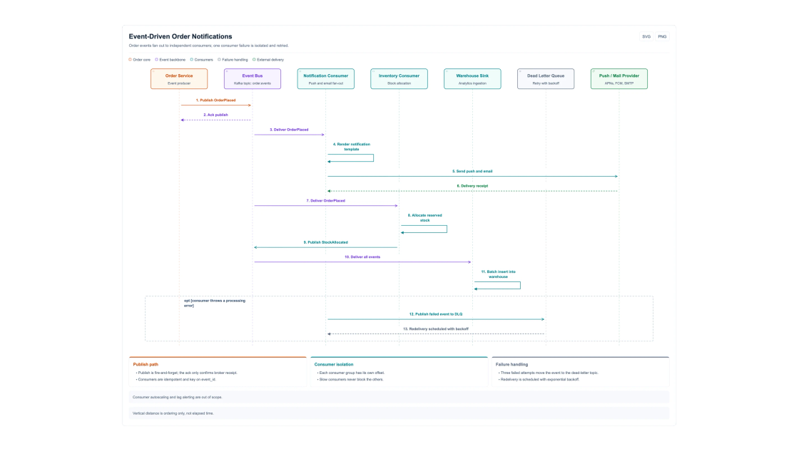

<p align="center">
  <picture>
    <source media="(prefers-color-scheme: dark)" srcset="../../public/penecho-readme-header-dark.webp">
    
  </picture>
</p>

<h1 align="center">Não é mais um agente de IA. Um jeito melhor de trabalhar com os seus.</h1>

<p align="center">Cada tarefa que você dá ao Claude Code, ao Codex ou a qualquer agente vira uma linha que você acompanha num relance, do seu Ask ao trabalho revisado.<br>Trabalho longo custa mais ou menos a metade, e quando as palavras não bastam, você desenha o que quer dizer no Canvas.</p>

<p align="center">
  <a href="https://github.com/penecho/penecho/releases"></a>
  <a href="https://www.npmjs.com/package/penecho"></a>
  <a href="../../LICENSE"></a>
  <a href="https://discord.gg/3jrPJ3mXdX"></a>
  <a href="../mcp-setup.md"></a>
</p>

<p align="center">
  <a href="https://github.com/penecho/penecho/releases"></a>
  <a href="https://github.com/penecho/penecho/releases"></a>
  <a href="https://penecho.ai"></a>
  <a href="https://buymeacoffee.com/penecho"></a>
</p>

<p align="center">
  <a href="#why-work-on-lines">Por que linhas</a> ·
  <a href="#from-ask-to-reviewed">Como funciona</a> ·
  <a href="#hand-over-the-whole-job">Orchestrator</a> ·
  <a href="#quick-start">Início rápido</a> ·
  <a href="#connect-your-ai-agent">Conecte seu agente</a> ·
  <a href="#whats-new-in-150">Novidades da 1.5</a> ·
  <a href="#buy-us-a-coffee">Pague um café para nós</a>
</p>

<p align="center">
  <sub><a href="../../README.md">English</a> ·
  <a href="README.zh-CN.md">简体中文</a> ·
  <a href="README.ja.md">日本語</a> ·
  <a href="README.ko.md">한국어</a> ·
  <a href="README.ru.md">Русский</a> ·
  <a href="README.es.md">Español</a> ·
  <strong>Português</strong> ·
  <a href="README.fr.md">Français</a> ·
  <a href="README.de.md">Deutsch</a></sub>
</p>

<p align="center">
  <a href="https://penecho.ai/lines.html#film"></a>
</p>
<p align="center"><a href="https://penecho.ai/lines.html#film"><strong>▶ Veja o PenEcho Lines em 2 minutos</strong></a> · <a href="https://github.com/penecho/penecho/releases/download/v0.1.0/penecho_lines.mp4">Baixar MP4</a></p>

<p align="center"><sub>Código aberto e gratuito no seu computador. Se o PenEcho poupa seu tempo, <a href="https://buymeacoffee.com/penecho">um café ☕</a> o mantém em frente.</sub></p>

<a name="why-work-on-lines"></a>

## Por que trabalhar em linhas

<p align="center"></p>

<sub>A economia é comparada com retomar a mesma conversa, então trabalhos longos economizam mais e tarefas curtas, menos.</sub>

<a name="from-ask-to-reviewed"></a>

## Do Ask ao Revisado

<table width="100%">
  <tr>
    <td width="33%" valign="top">
      <br>
      <strong>1 · Peça</strong><br>
      Escreva o que você quer. Escolha um diagrama, um Explorer ou slides se quiser a resposta em imagem.
    </td>
    <td width="33%" valign="top">
      <br>
      <strong>2 · Um agente trabalha</strong><br>
      Rode com o agente que preferir. A linha mostra o que ele está fazendo, e você pode pará-lo a qualquer momento.
    </td>
    <td width="33%" valign="top">
      <br>
      <strong>3 · Você revisa</strong><br>
      O resultado espera como A revisar. Marque como revisado ou adicione o próximo Ask na mesma linha.
    </td>
  </tr>
</table>

### Desenhe o que você quer dizer

<table width="100%">
  <tr>
    <td width="50%" valign="top">
      <br>
      <strong>Você circula uma caixa</strong> e escreve: “Mova o que eu circulei para a caixa docs folder.”
    </td>
    <td width="50%" valign="top">
      <br>
      <strong>O agente vê isso junto com suas palavras</strong> e move a caixa. A linha fica ao lado do Canvas o tempo todo.
    </td>
  </tr>
</table>

### Os Topics guardam o que o projeto sabe

<p align="center"></p>

Depois de cada tarefa, o agente arquiva o que aprendeu no assunto a que pertence. Um Topic se lê como uma página: o que se quer, o que está feito e o que falta. Todo agente lê a memória do projeto antes de começar.

<a name="hand-over-the-whole-job"></a>

## Entregue o trabalho inteiro

<p align="center"></p>

Dê um trabalho grande a um agente na aba **Orchestrator** de um projeto. Ele divide o trabalho, coloca o agente certo em cada parte, confere cada resultado em relação ao seu objetivo e informa uma só vez.

- **O agente certo para cada parte:** modelos fortes nas partes difíceis e mais baratos nas simples, para o melhor resultado pelo que você gasta.
- **Aprende quem é bom em quê:** cada trabalho concluído recebe uma nota, e essas notas escolhem os agentes do próximo trabalho do mesmo tipo.
- **Nada escondido:** cada parte é uma linha comum que você pode abrir, redirecionar ou parar, com o que custou.
- **Os agentes que você já tem:** Claude Code, Codex, OpenCode, Kimi e outros, no seu próprio computador.

## O Canvas por dentro

<table width="100%">
  <tr>
    <td width="33%" valign="top">
      <br>
      <strong>Esboce e pergunte</strong><br>
      Escrita à mão, equações, texto e imagens numa tela infinita. O PenEchoLLM sugere o próximo passo quando você faz uma pausa.
    </td>
    <td width="33%" valign="top">
      <a href="../assets/professional-diagrams/kubernetes.webp"></a><br>
      <strong>Diagramas profissionais</strong><br>
      Diagramas de arquitetura, de sequência e de fluxo com layout automático. Exporte em SVG ou PNG.
    </td>
    <td width="33%" valign="top">
      <br>
      <strong>Widgets que funcionam</strong><br>
      Calculadoras, quizzes e protótipos que rodam na tela e podem ser favoritados ou compartilhados.
    </td>
  </tr>
</table>

**Novo na 1.5: desenhem juntos.** Um clique cria um link em que qualquer pessoa desenha com você e com seu agente, ao vivo, sem conta. Links somente leitura se atualizam enquanto você trabalha, e qualquer Canvas pode ser baixado em PDF.

<a name="quick-start"></a>

## Início rápido

| | Para começar |
| --- | --- |
| **App para desktop** | macOS e Windows no [GitHub Releases](https://github.com/penecho/penecho/releases). Vem com tudo e se atualiza sozinho. |
| **npm** | Node.js 22.19+. Rode `npm i -g penecho`, depois `penecho`, e abra `localhost:3888`. |
| **Navegador** | Entre em [penecho.ai](https://penecho.ai) para usar modelos hospedados e telas na nuvem. Nada para instalar. |

```bash
npm install -g penecho
penecho             # abre http://localhost:3888
```

> [!TIP]
> Na primeira vez, escolha um código de acesso de seis dígitos (ou acesso aberto numa rede confiável). Adicione seus agentes e modelos em **Configurações**: Claude Code, Codex ou Kimi com login feito, sua própria chave de API ou os modelos do PenEcho.

<details>
<summary>Rodar a partir do código-fonte</summary>

```bash
git clone https://github.com/penecho/penecho.git
cd penecho
npm install
npm start
```

</details>

<a name="connect-your-ai-agent"></a>

## Conecte seu agente de IA

**Num projeto,** o PenEcho roda os agentes que você já tem: Claude Code, Codex, OpenCode, Pi, Kimi e outros. Adicione-os em **Configurações → Agents** ou continue trabalhando nos apps deles: o que dizem e mudam aparece sozinho na linha.

**Para ter um Canvas ao lado de qualquer chat,** cole uma linha no Claude Code, Codex, Cursor ou outro agente MCP:

```text
Set up PenEcho for me by following https://penecho.ai/agents.md
```

Depois é só pedir:

- *“Desenhe a arquitetura deste projeto na tela.”*
- *“Transforme nosso fluxo de login num diagrama de sequência na tela.”*
- *“Leia minhas notas à mão na tela e revise o diagrama.”*

O Canvas abre ao lado do seu chat. Não precisa de conta; se perguntar, escolha **Continuar como convidado**. O MCP não usa créditos do PenEcho.

<details>
<summary>MCP local para uma instalação global via npm</summary>

Ative o MCP em **Configurações → MCP** e use **Configurar automaticamente**, ou adicione esta entrada a um cliente que aceite JSON `mcpServers`:

```json
{
  "mcpServers": {
    "penecho": { "command": "penecho", "args": ["mcp"] }
  }
}
```

Os agentes só veem as telas que você ativar. O MCP local fica no seu computador; o MCP na nuvem usa uma autorização OAuth separada. [Guia do MCP →](../mcp-setup.md) · [Instalação do plugin](../../integrations/penecho-cloud/INSTALL.md)

</details>

<details>
<summary>Galeria de diagramas</summary>

<table width="100%">
  <tr>
    <td width="33%" valign="top"><a href="../assets/professional-diagrams/kubernetes.webp"></a><br><strong>Kubernetes cluster</strong></td>
    <td width="33%" valign="top"><a href="../assets/professional-diagrams/migration.webp"></a><br><strong>Monolith → microservices</strong></td>
    <td width="33%" valign="top"><a href="../assets/professional-diagrams/notifications.webp"></a><br><strong>Event-driven notifications</strong></td>
  </tr>
  <tr>
    <td valign="top"><a href="../assets/professional-diagrams/mcp-request.webp"></a><br><strong>How MCP reaches the canvas</strong></td>
    <td valign="top"><a href="../assets/professional-diagrams/release.webp"></a><br><strong>Release: parallel tasks</strong></td>
    <td valign="top"><a href="../assets/professional-diagrams/rollout.webp"></a><br><strong>Multi-region rollout</strong></td>
  </tr>
</table>

<p align="center"><sub>Clique em qualquer diagrama para vê-lo em tamanho real.</sub></p>

</details>

## Como funciona

<p align="center"></p>

- **No seu computador** — o app para desktop ou a CLI serve a tela e usa sua própria API de modelos ou a CLI do seu agente.
- **Na nuvem** — o penecho.ai acrescenta modelos hospedados, projetos sincronizados e compartilhados e links ao vivo para desenhar juntos.
- **Seu agente** — conecta-se pelo MCP local ou na nuvem. Os dois são opcionais.

Detalhes: [notas de arquitetura](../architecture.md).

## Escolha sua IA

| Conexão | Custo | Melhor para |
| --- | --- | --- |
| **Modelos do PenEcho** — entre e escolha um modelo | Créditos da conta | Começar sem chaves |
| **Sua API de modelos** — compatível com OpenAI ou Anthropic | Seu provedor | Controle total do modelo e do custo |
| **Sua CLI** — Codex, Claude Code ou Kimi com login feito | Seu plano | Aproveitar uma assinatura que você já tem |

Qual modelo e nível de raciocínio escolher: [modelos recomendados](#recommended-models) (atualizados a cada versão).

<a name="recommended-models"></a>
<details>
<summary>Modelos recomendados</summary>

Estas recomendações equilibram a qualidade das respostas e a latência do trabalho real do PenEcho na tela, com base nos testes práticos atuais; o tempo de resposta real varia com o provedor, a complexidade da tela e o raciocínio.

| Modelo | Nível | Observações | Uso recomendado |
| --- | --- | --- | --- |
| Claude Opus 4.8 / 5.0 (`claude-opus-4-8` / `claude-opus-5-0`) | `medium` | Qualidade forte com melhor equilíbrio de latência | Trabalho diário na tela |
| Claude Opus 4.8 / 5.0 (`claude-opus-4-8` / `claude-opus-5-0`) | `high` | Raciocínio de maior qualidade, esperas mais longas e variáveis | Escrita à mão complexa, matemática, diagramas ou layout |
| Fable 5 (`claude-fable-5` or `fable`) | `medium` | Muitas vezes cerca de metade do tempo de resposta do `gpt-5.6-sol` em `xhigh` | Uso geral rápido e de qualidade |
| [Kimi K3](https://platform.kimi.ai?aff=penecho) (`kimi-k3`) | `medium` | Qualidade muito boa; `medium` mantém o equilíbrio prático | Padrão recomendado para o Kimi |
| `gpt-5.6-terra` | de `low` a `high` | Surpreendentemente forte e ágil | Metas flexíveis de qualidade e latência |
| `gpt-5.6-luna` | `xhigh` | Resultados muito bons na tela com ótima velocidade | Qualidade em primeiro lugar, ainda ágil |
| `gpt-5.6-sol` | `high` | Bom o bastante para a maioria dos pedidos, mais ágil que `xhigh` | Padrão quando a agilidade importa |
| `gpt-5.6-sol` | `xhigh` | Muito bom, mas mais lento e variável | Tarefas difíceis na tela |
| `deepseek-v4-flash-vision-exp` | `medium` | Bom | Trabalho com visão pela API da DeepSeek |
| `glm-5.3-flash` | `medium` | Bom | Trabalho rápido pela API compatível com Anthropic do GLM |

</details>

<a name="whats-new-in-150"></a>

## Novidades da 1.5.0

- **PenEcho Lines:** cada tarefa é uma linha, do seu Ask ao trabalho revisado, com Topics, economia de tokens e qualquer agente na mesma linha.
- **Colaborar:** um clique cria um link em que qualquer pessoa desenha com você, ao vivo, sem conta.
- **Compartilhar e PDF:** links somente leitura se atualizam ao vivo enquanto você trabalha, e qualquer Canvas pode ser baixado em PDF.
- **Projetos de pasta:** agentes de IA que trabalham na mesma pasta dividem uma página; as telas dela são abas, e cada uma se salva sozinha.
- **Configuração do agente em uma linha:** “Set up PenEcho for me by following https://penecho.ai/agents.md”.

[Registro completo de mudanças →](../../CHANGELOG.md#150)

<a name="buy-us-a-coffee"></a>
<a name="support-penecho"></a>

## Pague um café para nós

<p align="center">
  <a href="https://buymeacoffee.com/penecho"></a>
</p>

O PenEcho é gratuito no seu computador, sem conta. Se ele poupou uma tarde, ou alguns milhões de tokens, um café é o jeito mais rápido de agradecer, e vai direto para desenvolvimento, testes e documentação.

<p align="center">
  <a href="https://buymeacoffee.com/penecho"></a>
  <a href="https://github.com/sponsors/penecho"></a>
</p>

Sem dinheiro sobrando? Uma ⭐ neste repositório, um relato de bug ou contar para um amigo ajuda do mesmo jeito.

<sub>As contribuições apoiam a manutenção do código aberto; não compram licença comercial, suporte dedicado nem recursos garantidos.</sub>

## Comunidade

| [Discord](https://discord.gg/3jrPJ3mXdX) | [Discussions](https://github.com/penecho/penecho/discussions) | [Issues](https://github.com/penecho/penecho/issues) | [Contributing](../../CONTRIBUTING.md) |
| --- | --- | --- | --- |
| Converse com a equipe | Ideias e perguntas | Relate um bug | Rode `npm run check` antes |

Licenciado sob [AGPL-3.0-only](../../LICENSE); há [licença comercial](../../COMMERCIAL-LICENSE.md) disponível. [Política de marcas](../../TRADEMARKS.md) · [Acordo de contribuidor](../../CONTRIBUTOR-LICENSE-AGREEMENT.md).

Os renderizadores de diagramas adaptam utilitários de SVG e geometria do [Archify](https://github.com/tt-a1i/archify), de tt-a1i (MIT). Veja [NOTICE](../../NOTICE).

<p align="center">
  <a href="https://www.kimi.com/code?aff=penecho">
    <picture>
      <source media="(prefers-color-scheme: dark)" srcset="../assets/kimi-open-source-friends-dark.svg">
      
    </picture>
  </a>
</p>

<p align="center">
  <a href="https://www.star-history.com/?repos=penecho%2Fpenecho&amp;type=date&amp;legend=top-left">
    <picture>
      <source media="(prefers-color-scheme: dark)" srcset="https://api.star-history.com/chart?repos=penecho/penecho&amp;type=date&amp;theme=dark&amp;legend=top-left">
      
    </picture>
  </a>
</p>
