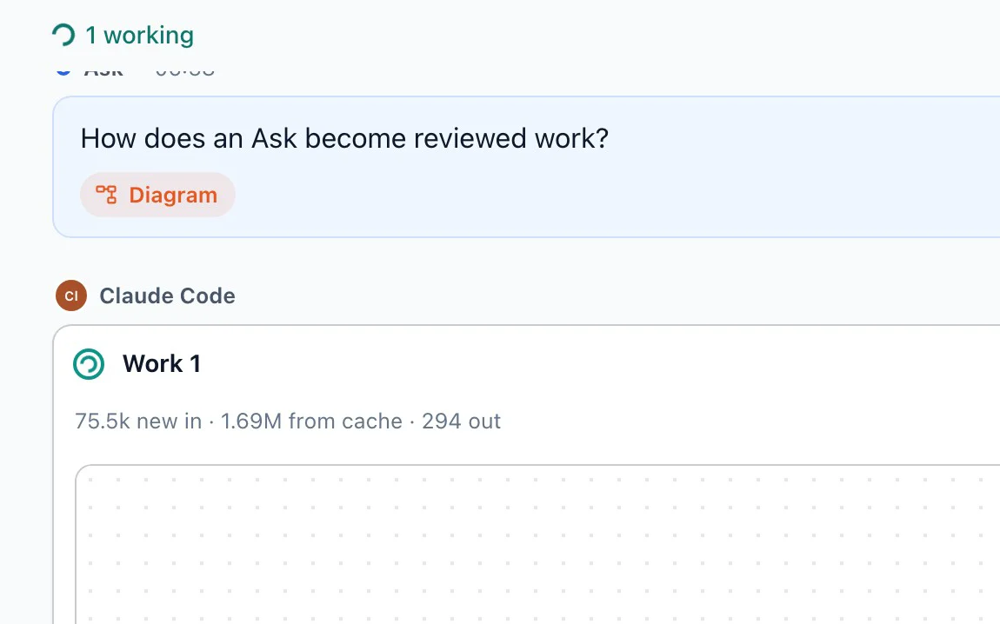
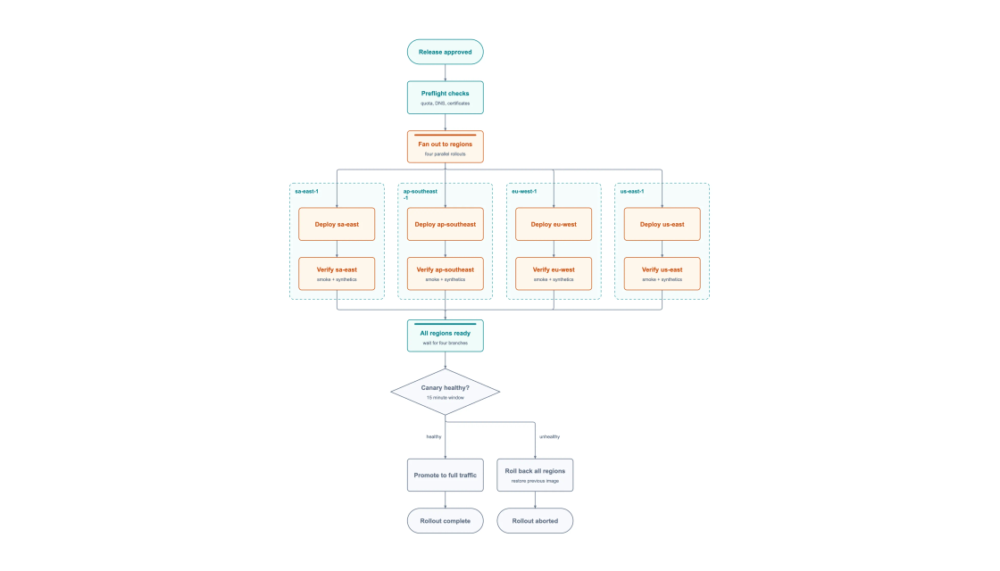
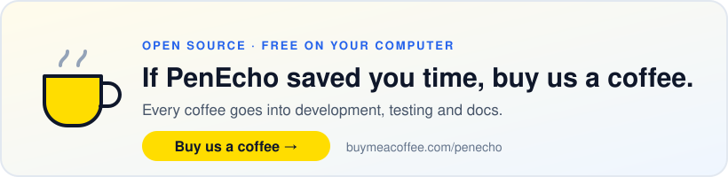

<p align="center">
  <picture>
    <source media="(prefers-color-scheme: dark)" srcset="../../public/penecho-readme-header-dark.webp">
    
  </picture>
</p>

<h1 align="center">Не ещё один ИИ-агент. Лучший способ работать с вашими.</h1>

<p align="center">Каждая задача, которую вы даёте Claude Code, Codex или любому агенту, становится линией, которую видно с одного взгляда: от вашего Ask до проверенной работы.<br>Долгая работа стоит примерно вдвое дешевле, а когда слов не хватает, вы рисуете то, что имеете в виду, на Canvas.</p>

<p align="center">
  <a href="https://github.com/penecho/penecho/releases"></a>
  <a href="https://www.npmjs.com/package/penecho"></a>
  <a href="../../LICENSE"></a>
  <a href="https://discord.gg/3jrPJ3mXdX"></a>
  <a href="../mcp-setup.md"></a>
</p>

<p align="center">
  <a href="https://github.com/penecho/penecho/releases"></a>
  <a href="https://github.com/penecho/penecho/releases"></a>
  <a href="https://penecho.ai"></a>
  <a href="https://buymeacoffee.com/penecho"></a>
</p>

<p align="center">
  <a href="#why-work-on-lines">Зачем линии</a> ·
  <a href="#from-ask-to-reviewed">Как это работает</a> ·
  <a href="#hand-over-the-whole-job">Orchestrator</a> ·
  <a href="#quick-start">Быстрый старт</a> ·
  <a href="#connect-your-ai-agent">Подключить агента</a> ·
  <a href="#whats-new-in-150">Что нового в 1.5</a> ·
  <a href="#buy-us-a-coffee">Угостить нас кофе</a>
</p>

<p align="center">
  <sub><a href="../../README.md">English</a> ·
  <a href="README.zh-CN.md">简体中文</a> ·
  <a href="README.ja.md">日本語</a> ·
  <a href="README.ko.md">한국어</a> ·
  <strong>Русский</strong> ·
  <a href="README.es.md">Español</a> ·
  <a href="README.pt-BR.md">Português</a> ·
  <a href="README.fr.md">Français</a> ·
  <a href="README.de.md">Deutsch</a></sub>
</p>

<p align="center">
  <a href="https://penecho.ai/lines.html#film"></a>
</p>
<p align="center"><a href="https://penecho.ai/lines.html#film"><strong>▶ PenEcho Lines за 2 минуты</strong></a> · <a href="https://github.com/penecho/penecho/releases/download/v0.1.0/penecho_lines.mp4">Скачать MP4</a></p>

<p align="center"><sub>Открытый код и бесплатно на вашем компьютере. Если PenEcho экономит вам время, <a href="https://buymeacoffee.com/penecho">чашка кофе ☕</a> помогает ему развиваться.</sub></p>

<a name="why-work-on-lines"></a>

## Зачем работать на линиях

<p align="center"></p>

<sub>Экономия считается по сравнению с продолжением того же разговора, поэтому долгая работа экономит больше всего, а короткие задачи — меньше.</sub>

<a name="from-ask-to-reviewed"></a>

## От Ask до проверки

<table width="100%">
  <tr>
    <td width="33%" valign="top">
      <br>
      <strong>1 · Ask</strong><br>
      Напишите, что вам нужно. Если хотите ответ картинкой, выберите схему, Explorer или слайды.
    </td>
    <td width="33%" valign="top">
      <br>
      <strong>2 · Агент работает</strong><br>
      Запустите с любимым агентом. Линия показывает, что он делает, и его можно остановить в любой момент.
    </td>
    <td width="33%" valign="top">
      <br>
      <strong>3 · Вы проверяете</strong><br>
      Результат ждёт со статусом «На проверку». Отметьте его проверенным или добавьте следующий Ask на ту же линию.
    </td>
  </tr>
</table>

### Нарисуйте, что имеете в виду

<table width="100%">
  <tr>
    <td width="50%" valign="top">
      <br>
      <strong>Вы обводите блок</strong> и пишете: «Перенеси то, что я обвёл, в блок docs folder».
    </td>
    <td width="50%" valign="top">
      <br>
      <strong>Агент видит это вместе с вашими словами</strong> и переносит блок. Линия всё время рядом с Canvas.
    </td>
  </tr>
</table>

### Topics хранят то, что знает проект

<p align="center"></p>

После каждой задачи агент раскладывает то, что узнал, по нужной теме. Topic читается как одна страница: что нужно, что сделано и что осталось. Каждый агент читает память проекта перед началом работы.

<a name="hand-over-the-whole-job"></a>

## Отдайте всю работу целиком

<p align="center"></p>

Дайте одному агенту большую работу на вкладке **Orchestrator** проекта. Он делит её, ставит на каждую часть подходящего агента, проверяет каждый результат по вашей цели и отчитывается один раз.

- **Нужный агент для каждой части:** сильные модели на сложных частях, дешёвые — на простых: лучший результат за ваши деньги.
- **Он узнаёт, кто в чём хорош:** каждая законченная работа получает оценку, и по этим оценкам выбираются агенты для следующей работы того же рода.
- **Ничего скрытого:** каждая часть — обычная линия, которую можно открыть, направить или остановить, и видно, сколько она стоила.
- **Агенты, которые у вас уже есть:** Claude Code, Codex, OpenCode, Kimi и другие, на вашем компьютере.

## Canvas внутри

<table width="100%">
  <tr>
    <td width="33%" valign="top">
      <br>
      <strong>Набросайте, потом спросите</strong><br>
      Рукописный текст, формулы, текст и изображения на бесконечном холсте. Когда вы делаете паузу, PenEchoLLM предлагает следующий шаг.
    </td>
    <td width="33%" valign="top">
      <a href="../assets/professional-diagrams/kubernetes.webp"></a><br>
      <strong>Профессиональные схемы</strong><br>
      Архитектурные, последовательные и процессные схемы с автоматической раскладкой. Экспорт в SVG или PNG.
    </td>
    <td width="33%" valign="top">
      <br>
      <strong>Рабочие виджеты</strong><br>
      Калькуляторы, тесты и прототипы работают прямо на холсте, их можно добавить в избранное или поделиться ими.
    </td>
  </tr>
</table>

**Новое в 1.5: рисуйте вместе.** Один клик создаёт ссылку, по которой любой может рисовать с вами и вашим агентом в реальном времени, без аккаунта. Ссылки только для просмотра обновляются по ходу работы, а любой Canvas можно скачать в PDF.

<a name="quick-start"></a>

## Быстрый старт

| | Начать |
| --- | --- |
| **Приложение** | macOS и Windows на [GitHub Releases](https://github.com/penecho/penecho/releases). Всё включено, обновляется само. |
| **npm** | Node.js 22.19+. Выполните `npm i -g penecho`, затем `penecho`, и откройте `localhost:3888`. |
| **Браузер** | Войдите на [penecho.ai](https://penecho.ai), чтобы пользоваться облачными моделями и холстами. Ничего не нужно устанавливать. |

```bash
npm install -g penecho
penecho             # открывает http://localhost:3888
```

> [!TIP]
> При первом запуске задайте шестизначный код доступа (или откройте доступ в доверенной сети). Добавьте агентов и модели в **Настройках**: вошедшие в аккаунт Claude Code, Codex или Kimi, ваш API-ключ или модели PenEcho.

<details>
<summary>Запуск из исходников</summary>

```bash
git clone https://github.com/penecho/penecho.git
cd penecho
npm install
npm start
```

</details>

<a name="connect-your-ai-agent"></a>

## Подключите ИИ-агента

**В проекте** PenEcho запускает агентов, которые у вас уже есть: Claude Code, Codex, OpenCode, Pi, Kimi и других. Добавьте их в **Настройки → Agents** или продолжайте работать в их приложениях: всё, что они говорят и меняют, само появляется на линии.

**Чтобы открыть Canvas рядом с любым чатом,** вставьте одну строку в Claude Code, Codex, Cursor или другого MCP-агента:

```text
Set up PenEcho for me by following https://penecho.ai/agents.md
```

А потом просто попросите:

- *«Нарисуй архитектуру этого проекта на холсте».*
- *«Преврати наш процесс входа в диаграмму последовательности на холсте».*
- *«Прочитай мои рукописные заметки на холсте и исправь схему».*

Canvas открывается рядом с чатом. Аккаунт не нужен; если спросят, выберите **Продолжить как гость**. MCP не тратит кредиты PenEcho.

<details>
<summary>Локальный MCP для глобальной установки через npm</summary>

Включите MCP в **Настройки → MCP** и нажмите **Автонастройка** или добавьте эту запись в клиент, который принимает JSON `mcpServers`:

```json
{
  "mcpServers": {
    "penecho": { "command": "penecho", "args": ["mcp"] }
  }
}
```

Агенты видят только холсты, которые вы включили. Локальный MCP остаётся на вашем компьютере; облачный MCP использует отдельную авторизацию OAuth. [Руководство по MCP →](../mcp-setup.md) · [Установка плагина](../../integrations/penecho-cloud/INSTALL.md)

</details>

<details>
<summary>Галерея схем</summary>

<table width="100%">
  <tr>
    <td width="33%" valign="top"><a href="../assets/professional-diagrams/kubernetes.webp"></a><br><strong>Kubernetes cluster</strong></td>
    <td width="33%" valign="top"><a href="../assets/professional-diagrams/migration.webp"></a><br><strong>Monolith → microservices</strong></td>
    <td width="33%" valign="top"><a href="../assets/professional-diagrams/notifications.webp"></a><br><strong>Event-driven notifications</strong></td>
  </tr>
  <tr>
    <td valign="top"><a href="../assets/professional-diagrams/mcp-request.webp"></a><br><strong>How MCP reaches the canvas</strong></td>
    <td valign="top"><a href="../assets/professional-diagrams/release.webp"></a><br><strong>Release: parallel tasks</strong></td>
    <td valign="top"><a href="../assets/professional-diagrams/rollout.webp"></a><br><strong>Multi-region rollout</strong></td>
  </tr>
</table>

<p align="center"><sub>Нажмите на схему, чтобы открыть её в полном размере.</sub></p>

</details>

## Как это устроено

<p align="center"></p>

- **На вашем компьютере** — приложение или CLI обслуживает холст и использует ваш API моделей или CLI агента.
- **В облаке** — penecho.ai добавляет облачные модели, синхронизируемые и общие проекты и живые ссылки для совместного рисования.
- **Ваш агент** — подключается через локальный или облачный MCP. Оба необязательны.

Подробнее: [заметки об архитектуре](../architecture.md).

## Выберите ИИ

| Подключение | Стоимость | Лучше всего для |
| --- | --- | --- |
| **Модели PenEcho** — войдите и выберите модель | Кредиты аккаунта | Быстрый старт без ключей |
| **Ваш API моделей** — совместимый с OpenAI или Anthropic | Ваш провайдер | Полный контроль над моделью и затратами |
| **Ваш CLI** — Codex, Claude Code или Kimi с входом в аккаунт | Ваш тариф | Использовать подписку, которая у вас уже есть |

Какую модель и уровень рассуждения выбрать: [рекомендуемые модели](#recommended-models) (обновляются с каждым выпуском).

<a name="recommended-models"></a>
<details>
<summary>Рекомендуемые модели</summary>

Эти рекомендации уравновешивают качество ответа и задержку на реальной работе PenEcho с холстом по итогам текущих практических тестов; фактическое время ответа зависит от провайдера, сложности холста и поведения рассуждения.

| Модель | Уровень | Заметки | Рекомендуемое применение |
| --- | --- | --- | --- |
| Claude Opus 4.8 / 5.0 (`claude-opus-4-8` / `claude-opus-5-0`) | `medium` | Высокое качество с лучшим балансом задержки | Повседневная работа с холстом |
| Claude Opus 4.8 / 5.0 (`claude-opus-4-8` / `claude-opus-5-0`) | `high` | Выше качество рассуждения, ожидание дольше и менее предсказуемо | Сложный рукописный текст, математика, схемы или раскладка |
| Fable 5 (`claude-fable-5` or `fable`) | `medium` | Часто примерно вдвое быстрее, чем `gpt-5.6-sol` на `xhigh` | Быстрая и качественная повседневная работа |
| [Kimi K3](https://platform.kimi.ai?aff=penecho) (`kimi-k3`) | `medium` | Очень хорошее качество; `medium` делает баланс практичным | Рекомендуемое значение для Kimi |
| `gpt-5.6-terra` | от `low` до `high` | Неожиданно сильная и отзывчивая | Гибкие цели по качеству и задержке |
| `gpt-5.6-luna` | `xhigh` | Очень хорошие результаты на холсте и высокая скорость | Сначала качество, но всё ещё быстро |
| `gpt-5.6-sol` | `high` | Достаточно для большинства запросов, отзывчивее, чем `xhigh` | По умолчанию, когда важна отзывчивость |
| `gpt-5.6-sol` | `xhigh` | Очень хорошо, но медленнее и менее предсказуемо | Сложные задачи на холсте |
| `deepseek-v4-flash-vision-exp` | `medium` | Хорошо | Работа с изображениями через DeepSeek API |
| `glm-5.3-flash` | `medium` | Хорошо | Быстрая работа через Anthropic-совместимый API GLM |

</details>

<a name="whats-new-in-150"></a>

## Что нового в 1.5.0

- **PenEcho Lines:** каждая задача — линия от вашего Ask до проверенной работы, с Topics, экономией токенов и любым агентом на той же линии.
- **Совместная работа:** один клик создаёт ссылку, по которой любой может рисовать с вами в реальном времени, без аккаунта.
- **Ссылки и PDF:** ссылки только для просмотра обновляются в реальном времени, а любой Canvas можно скачать в PDF.
- **Проекты-папки:** ИИ-агенты, работающие в одной папке, делят одну страницу; её холсты — это вкладки, и каждый сохраняется сам.
- **Настройка агента одной строкой:** «Set up PenEcho for me by following https://penecho.ai/agents.md».

[Полный список изменений →](../../CHANGELOG.md#150)

<a name="buy-us-a-coffee"></a>
<a name="support-penecho"></a>

## Угостите нас кофе

<p align="center">
  <a href="https://buymeacoffee.com/penecho"></a>
</p>

PenEcho бесплатен на вашем компьютере, без аккаунта. Если он сэкономил вам полдня или несколько миллионов токенов, кофе — самый быстрый способ сказать спасибо, и деньги идут прямо на разработку, тестирование и документацию.

<p align="center">
  <a href="https://buymeacoffee.com/penecho"></a>
  <a href="https://github.com/sponsors/penecho"></a>
</p>

Нет лишних денег? ⭐ этому репозиторию, сообщение об ошибке или рассказ другу помогают не меньше.

<sub>Пожертвования поддерживают сопровождение открытого кода; они не покупают коммерческую лицензию, отдельную поддержку или гарантированные функции.</sub>

## Сообщество

| [Discord](https://discord.gg/3jrPJ3mXdX) | [Discussions](https://github.com/penecho/penecho/discussions) | [Issues](https://github.com/penecho/penecho/issues) | [Contributing](../../CONTRIBUTING.md) |
| --- | --- | --- | --- |
| Чат с командой | Идеи и вопросы | Сообщить об ошибке | Сначала выполните `npm run check` |

Распространяется по лицензии [AGPL-3.0-only](../../LICENSE); доступна [коммерческая лицензия](../../COMMERCIAL-LICENSE.md). [Политика товарных знаков](../../TRADEMARKS.md) · [Соглашение участника](../../CONTRIBUTOR-LICENSE-AGREEMENT.md).

Рендереры схем используют адаптированные SVG- и геометрические помощники из [Archify](https://github.com/tt-a1i/archify) от tt-a1i (MIT). См. [NOTICE](../../NOTICE).

<p align="center">
  <a href="https://www.kimi.com/code?aff=penecho">
    <picture>
      <source media="(prefers-color-scheme: dark)" srcset="../assets/kimi-open-source-friends-dark.svg">
      
    </picture>
  </a>
</p>

<p align="center">
  <a href="https://www.star-history.com/?repos=penecho%2Fpenecho&amp;type=date&amp;legend=top-left">
    <picture>
      <source media="(prefers-color-scheme: dark)" srcset="https://api.star-history.com/chart?repos=penecho/penecho&amp;type=date&amp;theme=dark&amp;legend=top-left">
      
    </picture>
  </a>
</p>
