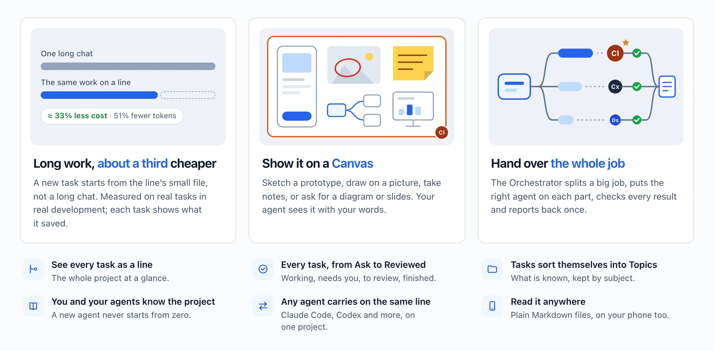
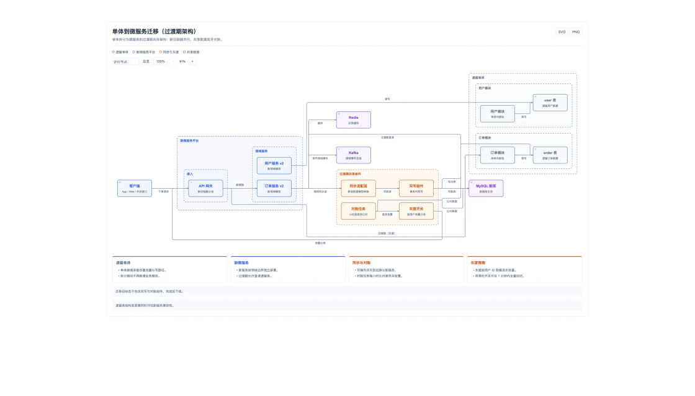

<p align="center">
  <picture>
    <source media="(prefers-color-scheme: dark)" srcset="../../public/penecho-readme-header-dark.webp">
    
  </picture>
</p>

<h1 align="center">不是又一个 AI Agent，而是与你的 Agent 协作的更好方式。</h1>

<p align="center">你交给 Claude Code、Codex 或任何 Agent 的每个任务，都会变成一条一眼看清的线，从你的 Ask 到审阅完成。<br>长任务花费约一半；说不清的时候，就在画布上把意思画出来。</p>

<p align="center">
  <a href="https://github.com/penecho/penecho/releases"></a>
  <a href="https://www.npmjs.com/package/penecho"></a>
  <a href="../../LICENSE"></a>
  <a href="https://discord.gg/3jrPJ3mXdX"></a>
  <a href="../mcp-setup.md"></a>
</p>

<p align="center">
  <a href="https://github.com/penecho/penecho/releases"></a>
  <a href="https://github.com/penecho/penecho/releases"></a>
  <a href="https://penecho.ai"></a>
  <a href="https://buymeacoffee.com/penecho"></a>
</p>

<p align="center">
  <a href="#why-work-on-lines">为什么用线</a> ·
  <a href="#from-ask-to-reviewed">怎么用</a> ·
  <a href="#hand-over-the-whole-job">Orchestrator</a> ·
  <a href="#quick-start">快速开始</a> ·
  <a href="#connect-your-ai-agent">连接你的 Agent</a> ·
  <a href="#whats-new-in-150">1.5 新内容</a> ·
  <a href="#buy-us-a-coffee">请我们喝杯咖啡</a>
</p>

<p align="center">
  <sub><a href="../../README.md">English</a> ·
  <strong>简体中文</strong> ·
  <a href="README.ja.md">日本語</a> ·
  <a href="README.ko.md">한국어</a> ·
  <a href="README.ru.md">Русский</a> ·
  <a href="README.es.md">Español</a> ·
  <a href="README.pt-BR.md">Português</a> ·
  <a href="README.fr.md">Français</a> ·
  <a href="README.de.md">Deutsch</a></sub>
</p>

<p align="center">
  <a href="https://penecho.ai/lines.html#film"></a>
</p>
<p align="center"><a href="https://penecho.ai/lines.html#film"><strong>▶ 两分钟看懂 PenEcho Lines</strong></a> · <a href="https://github.com/penecho/penecho/releases/download/v0.1.0/penecho_lines.mp4">下载 MP4</a></p>

<p align="center"><sub>开源，在你的电脑上免费。如果 PenEcho 帮你省了时间，<a href="https://buymeacoffee.com/penecho">一杯咖啡 ☕</a> 能让它继续走下去。</sub></p>

<a name="why-work-on-lines"></a>

## 为什么在线上工作

<p align="center"></p>

<sub>节省量是与继续同一段对话相比得出的，所以长任务省得最多，短任务省得少一些。</sub>

<a name="from-ask-to-reviewed"></a>

## 从 Ask 到已审阅

<table width="100%">
  <tr>
    <td width="33%" valign="top">
      <br>
      <strong>1 · 提问</strong><br>
      写下你想要的。想要一张图作为回答，就选图表、Explorer 或幻灯片。
    </td>
    <td width="33%" valign="top">
      <br>
      <strong>2 · Agent 工作</strong><br>
      用你喜欢的 Agent 运行。线上会显示它正在做什么，你随时可以停下它。
    </td>
    <td width="33%" valign="top">
      <br>
      <strong>3 · 你来审阅</strong><br>
      结果以“待审阅”等着你。标记为已审阅，或在同一条线上接着提下一个 Ask。
    </td>
  </tr>
</table>

### 把意思画出来

<table width="100%">
  <tr>
    <td width="50%" valign="top">
      <br>
      <strong>你圈出一个方框</strong>，写下：“把我圈的移到 docs folder 框里。”
    </td>
    <td width="50%" valign="top">
      <br>
      <strong>Agent 连同你的话一起看到它</strong>，把那个方框移了过去。这条线始终就在画布旁边。
    </td>
  </tr>
</table>

### Topic 记住项目知道的一切

<p align="center"></p>

每做完一个任务，Agent 会把学到的内容归到所属的主题下。一个 Topic 读起来就是一页：要什么、做了什么、还剩什么。每个 Agent 开工前都会先读项目记忆。

<a name="hand-over-the-whole-job"></a>

## 把整件事交出去

<p align="center"></p>

在项目的 **Orchestrator** 页里，把一件大事交给一个 Agent。它会拆分任务，给每一部分安排合适的 Agent，对照你的目标检查每个结果，最后一次向你汇报。

- **每一部分用合适的 Agent：** 难的部分用强模型，简单的部分用便宜的模型，花同样的钱得到最好的结果。
- **它知道谁擅长什么：** 每个完成的任务都会打分，这些分数决定下一次同类任务交给哪个 Agent。
- **没有任何隐藏：** 每一部分都是一条普通的线，你可以打开、调整或停止，并看到它花了多少。
- **用你已有的 Agent：** Claude Code、Codex、OpenCode、Kimi 等，都在你自己的电脑上。

## 内置画布

<table width="100%">
  <tr>
    <td width="33%" valign="top">
      <br>
      <strong>先画，再问</strong><br>
      在无限画布上手写、写公式、打字、放图片。你停下来时，PenEchoLLM 会建议下一步。
    </td>
    <td width="33%" valign="top">
      <a href="../assets/professional-diagrams/kubernetes.webp"></a><br>
      <strong>专业图表</strong><br>
      架构图、时序图和流程图，自动排版。可导出 SVG 或 PNG。
    </td>
    <td width="33%" valign="top">
      <br>
      <strong>能用的组件</strong><br>
      计算器、测验和原型直接在画布上运行，可以收藏或分享。
    </td>
  </tr>
</table>

**1.5 新功能：一起画。** 点一下就生成一条链接，任何人都能和你、和你的 Agent 实时一起画，无需账号。只读链接会随你的修改实时更新，任何画布都能下载为 PDF。

<a name="quick-start"></a>

## 快速开始

| | 开始使用 |
| --- | --- |
| **桌面应用** | macOS 和 Windows 版见 [GitHub Releases](https://github.com/penecho/penecho/releases)。功能齐全，自动更新。 |
| **npm** | 需要 Node.js 22.19+。运行 `npm i -g penecho`，再运行 `penecho`，打开 `localhost:3888`。 |
| **浏览器** | 在 [penecho.ai](https://penecho.ai) 登录，即可使用托管模型和云端画布。无需安装。 |

```bash
npm install -g penecho
penecho             # 打开 http://localhost:3888
```

> [!TIP]
> 第一次启动时，设一个六位数的访问码（或在可信网络中开放访问）。在 **设置** 中添加你的 Agent 和模型：已登录的 Claude Code、Codex 或 Kimi，你自己的 API key，或 PenEcho 模型。

<details>
<summary>从源码运行</summary>

```bash
git clone https://github.com/penecho/penecho.git
cd penecho
npm install
npm start
```

</details>

<a name="connect-your-ai-agent"></a>

## 连接你的 AI Agent

**在项目里，** PenEcho 会运行你已有的 Agent：Claude Code、Codex、OpenCode、Pi、Kimi 等。在 **设置 → Agents** 中添加它们，或者继续在它们自己的应用里工作：它们说的和改的，会自动出现在线上。

**想在任何对话旁边开一块画布，** 把这一行粘贴到 Claude Code、Codex、Cursor 或其他 MCP Agent 中：

```text
Set up PenEcho for me by following https://penecho.ai/agents.md
```

然后直接说：

- *“把这个项目的架构画在画布上。”*
- *“把我们的登录流程画成画布上的时序图。”*
- *“读一下我在画布上的手写笔记，然后修改这张图。”*

画布会在你的对话旁边打开。不需要账号；如有提示，选择 **以访客身份继续**。MCP 不消耗 PenEcho 积分。

<details>
<summary>全局 npm 安装的本地 MCP</summary>

在 **设置 → MCP** 中打开 MCP，然后用 **自动配置**，或把这一项加到接受 `mcpServers` JSON 的客户端：

```json
{
  "mcpServers": {
    "penecho": { "command": "penecho", "args": ["mcp"] }
  }
}
```

Agent 只能看到你打开的画布。本地 MCP 只在你的电脑上；云端 MCP 使用单独的 OAuth 授权。[MCP 指南 →](../mcp-setup.md) · [插件安装](../../integrations/penecho-cloud/INSTALL.md)

</details>

<details>
<summary>图表示例</summary>

<table width="100%">
  <tr>
    <td width="33%" valign="top"><a href="../assets/professional-diagrams/kubernetes.webp"></a><br><strong>Kubernetes cluster</strong></td>
    <td width="33%" valign="top"><a href="../assets/professional-diagrams/migration.webp"></a><br><strong>Monolith → microservices</strong></td>
    <td width="33%" valign="top"><a href="../assets/professional-diagrams/notifications.webp"></a><br><strong>Event-driven notifications</strong></td>
  </tr>
  <tr>
    <td valign="top"><a href="../assets/professional-diagrams/mcp-request.webp"></a><br><strong>How MCP reaches the canvas</strong></td>
    <td valign="top"><a href="../assets/professional-diagrams/release.webp"></a><br><strong>Release: parallel tasks</strong></td>
    <td valign="top"><a href="../assets/professional-diagrams/rollout.webp"></a><br><strong>Multi-region rollout</strong></td>
  </tr>
</table>

<p align="center"><sub>点任意一张图查看大图。</sub></p>

</details>

## 工作原理

<p align="center"></p>

- **在你的电脑上** — 桌面应用或命令行提供画布，并使用你自己的模型 API 或 Agent 命令行。
- **在云端** — penecho.ai 提供托管模型、同步和共享的项目，以及一起画的实时链接。
- **你的 Agent** — 通过本地或云端 MCP 连接。两者都是可选的。

详情：[架构说明](../architecture.md)。

## 选择你的 AI

| 连接方式 | 费用 | 适合 |
| --- | --- | --- |
| **PenEcho 模型** — 登录后选一个模型 | 账户积分 | 快速上手，不用 key |
| **你的模型 API** — 兼容 OpenAI 或 Anthropic | 你的服务商 | 完全掌控模型和费用 |
| **你的命令行** — 已登录的 Codex、Claude Code 或 Kimi | 你的订阅 | 复用你已有的订阅 |

选哪个模型、用多大推理强度：见 [推荐模型](#recommended-models)（每次发布都会更新）。

<a name="recommended-models"></a>
<details>
<summary>推荐模型</summary>

这些推荐基于目前的实际测试，在回答质量与 PenEcho 真实画布任务的延迟之间取得平衡；实际响应时间会因服务商、画布复杂度和推理方式而不同。

| 模型 | 推理强度 | 说明 | 推荐用途 |
| --- | --- | --- | --- |
| Claude Opus 4.8 / 5.0 (`claude-opus-4-8` / `claude-opus-5-0`) | `medium` | 质量强，延迟更均衡 | 日常画布工作 |
| Claude Opus 4.8 / 5.0 (`claude-opus-4-8` / `claude-opus-5-0`) | `high` | 推理质量更高，等待更长、更不稳定 | 复杂的手写、数学、图表或排版 |
| Fable 5 (`claude-fable-5` or `fable`) | `medium` | 响应时间常常只有 `xhigh` 下 `gpt-5.6-sol` 的一半左右 | 快速、高质量的日常使用 |
| [Kimi K3](https://platform.kimi.ai?aff=penecho) (`kimi-k3`) | `medium` | 质量很好；`medium` 让平衡更实用 | 推荐的 Kimi 默认设置 |
| `gpt-5.6-terra` | `low` 到 `high` | 出乎意料地强，而且响应快 | 灵活调整质量和延迟 |
| `gpt-5.6-luna` | `xhigh` | 画布效果很好，速度也快 | 质量优先，依然够快 |
| `gpt-5.6-sol` | `high` | 对大多数请求足够好，比 `xhigh` 响应更快 | 重视响应速度时的默认选择 |
| `gpt-5.6-sol` | `xhigh` | 很好，但更慢、更不稳定 | 困难的画布任务 |
| `deepseek-v4-flash-vision-exp` | `medium` | 好 | 通过 DeepSeek API 处理需要视觉的工作 |
| `glm-5.3-flash` | `medium` | 好 | 通过 GLM 的 Anthropic 兼容 API 快速工作 |

</details>

<a name="whats-new-in-150"></a>

## 1.5.0 新内容

- **PenEcho Lines：** 每个任务都是一条线，从你的 Ask 到审阅完成，配有 Topic、token 节省，任意 Agent 都能接着同一条线做。
- **一起画：** 点一下就生成一条链接，任何人都能和你实时一起画，无需账号。
- **分享和 PDF：** 只读链接随你的修改实时更新，任何画布都能下载为 PDF。
- **文件夹项目：** 在同一个文件夹里工作的 AI Agent 共用一个页面；其中的画布是标签页，各自自动保存。
- **一句话配置 Agent：** “Set up PenEcho for me by following https://penecho.ai/agents.md”。

[完整更新日志 →](../../CHANGELOG.md#150)

<a name="buy-us-a-coffee"></a>
<a name="support-penecho"></a>

## 请我们喝杯咖啡

<p align="center">
  <a href="https://buymeacoffee.com/penecho"></a>
</p>

PenEcho 在你的电脑上免费使用，无需账号。如果它帮你省下一个下午，或几百万个 token，一杯咖啡是最快的道谢方式，钱会直接用在开发、测试和文档上。

<p align="center">
  <a href="https://buymeacoffee.com/penecho"></a>
  <a href="https://github.com/sponsors/penecho"></a>
</p>

手头不宽裕？给这个仓库点个 ⭐、报告一个 bug，或者告诉一个朋友，帮助一样大。

<sub>捐助用于支持开源维护，并不购买商业许可、专属支持或任何功能承诺。</sub>

## 社区

| [Discord](https://discord.gg/3jrPJ3mXdX) | [Discussions](https://github.com/penecho/penecho/discussions) | [Issues](https://github.com/penecho/penecho/issues) | [Contributing](../../CONTRIBUTING.md) |
| --- | --- | --- | --- |
| 和团队聊天 | 想法和问题 | 报告 bug | 先运行 `npm run check` |

采用 [AGPL-3.0-only](../../LICENSE) 许可；也提供 [商业许可](../../COMMERCIAL-LICENSE.md)。[商标政策](../../TRADEMARKS.md) · [贡献者协议](../../CONTRIBUTOR-LICENSE-AGREEMENT.md)。

图表渲染器改编自 tt-a1i 的 [Archify](https://github.com/tt-a1i/archify)（MIT）中的 SVG 和几何工具。见 [NOTICE](../../NOTICE)。

<p align="center">
  <a href="https://www.kimi.com/code?aff=penecho">
    <picture>
      <source media="(prefers-color-scheme: dark)" srcset="../assets/kimi-open-source-friends-dark.svg">
      
    </picture>
  </a>
</p>

<p align="center">
  <a href="https://www.star-history.com/?repos=penecho%2Fpenecho&amp;type=date&amp;legend=top-left">
    <picture>
      <source media="(prefers-color-scheme: dark)" srcset="https://api.star-history.com/chart?repos=penecho/penecho&amp;type=date&amp;theme=dark&amp;legend=top-left">
      
    </picture>
  </a>
</p>
