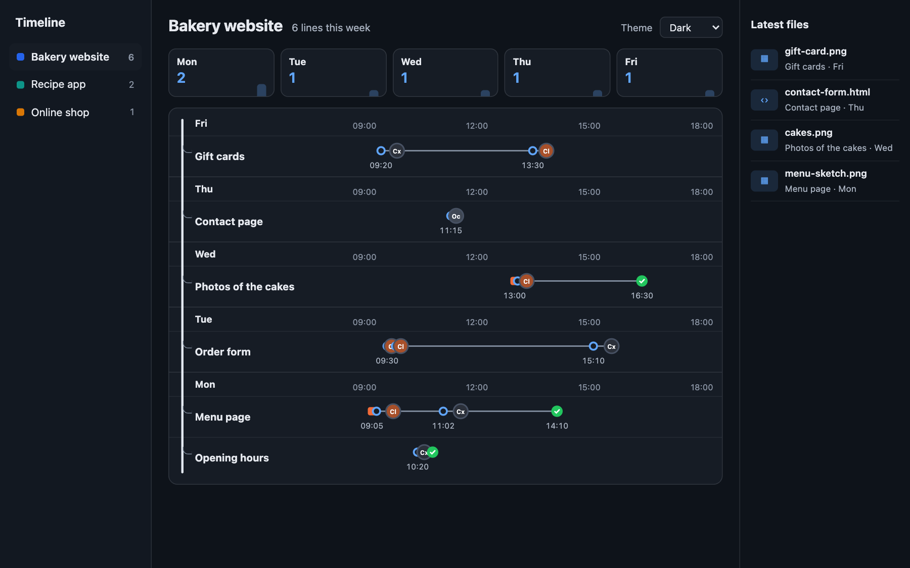

# Dark mode

<!-- status: PenEcho keeps this current -->
> [!status] Finished. The changes are on dark-mode, not merged
<!-- /status -->

## Ask · {{when -1 09:48}}

People keep asking for dark mode. What are our options? Don't build anything yet.

## [x] Work 1 · @claude · 6 min

Three ways to do it, smallest first:

| | What you get | Work |
|---|---|---|
| **A. Follow the computer** | Dark when the computer is dark, with no choice | Small |
| **B. Light, Dark or System** | A Theme menu at the top; System to start with, so most people never touch it | Small to medium |
| **C. A theme per project** | Each project in its own colours | Large, and nobody asked for it |

**I recommend B.** It is A plus one menu, and it also answers people who want dark in daylight. Whichever you choose, every colour first becomes a variable; Dark is then one more set of values. I have not changed anything.

[Details](../works/dark-mode/work-1.md)

## Ask · {{when -1 11:20}}

Check Claude's plan against our code. What does it miss?

> Refers to [Work 1](../works/dark-mode/work-1.md): Three ways to do it, smallest first:

## [x] Work 2 · @codex · 7 min

The plan holds. Four things it misses in our code, on the homepage branch:

1. `home.js` paints the dots itself (`NODE`, and `stroke="#94a3b8"` on each line), so they would stay light. They need classes, with their colours in `style.css`.
2. The theme has to be set in `<head>`, before `style.css`, or a dark page flashes white every time it opens.
3. The week's bars use `rgba(37, 99, 235, .18)`, which is too faint on a dark background. Dark needs its own.
4. System should follow the computer while the page is open, not only when it loads.

The agents' colours (Claude, Codex, OpenCode) read on both backgrounds and can stay as they are.

[Details](../works/dark-mode/work-2.md)

## Ask · {{when -1 14:58}}

Build B with your four points. Make it a new branch from homepage, since dark mode is for the new homepage.

## [x] Work 3 · @codex · 22 min

**Dark mode is in,** as option B with the four points, on a new branch `dark-mode` made from `homepage`.

- Added `theme.js`: Light, Dark or System, kept on this computer and set before the page paints
- `style.css`: every colour is a variable, with a second set for Dark
- `home.js`: the dots, lines and trunk get classes instead of colours
- `index.html`: the Theme menu at the top right

It is built on the homepage, so it merges after `homepage`. Nothing is merged into main.

[Details](../works/dark-mode/work-3.md)
