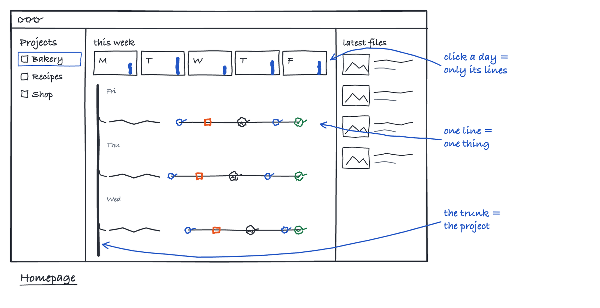
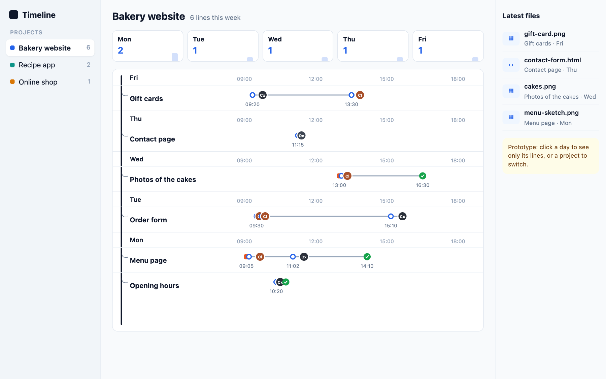
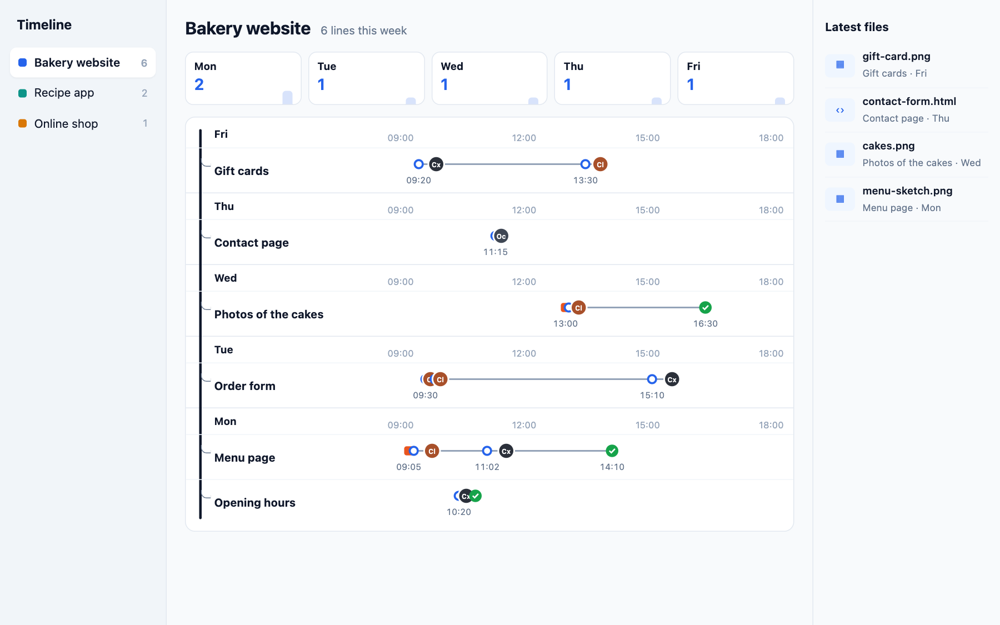

# Homepage from my drawing

<!-- status: PenEcho keeps this current -->
> [!status] Finished. The changes are on homepage, not merged
<!-- /status -->

## Canvas · {{when -3 09:24}}

## Ask · {{when -3 09:31}}

Make a clickable prototype of this homepage, on the Canvas. Keep to what I drew.

> On the Canvas [Homepage sketch](../files/homepage-from-my-drawing/sketch.penecho.json)

## [x] Work 1 · @claude · 11 min

**A clickable prototype of your drawing is on the Canvas.** Projects on the left, the week across the top, every line on one trunk with its steps, and the latest files on the right. Click a day to see only its lines, or a project to switch.

I kept to what you drew. Two things I chose: the newest day is at the top, and each step has its time under it, unless it would run into the one before; that one shows when you point at the step.

[Details](../works/homepage-from-my-drawing/work-1.md)

## Ask · {{when -3 13:58}}

Looks right. Build it in the app like the prototype.

> Refers to [Work 1](../works/homepage-from-my-drawing/work-1.md): A clickable prototype of your drawing is on the Canvas.

## [x] Work 2 · @codex · 29 min

**The homepage is built** as in the prototype, on the branch `homepage`.

- Added `home.js`, which draws the whole page; `timeline.js` is gone
- Changed `index.html`, `style.css` and `data.js`, which now has the projects and their files
- Opened it in a browser and clicked through the days and the projects

Nothing is merged into main.

[Details](../works/homepage-from-my-drawing/work-2.md)
