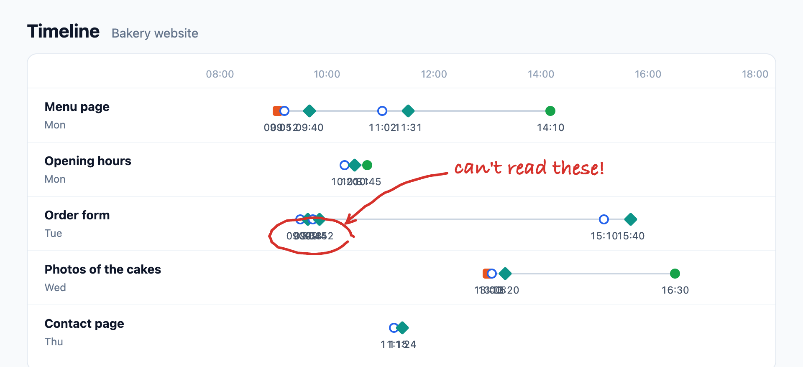
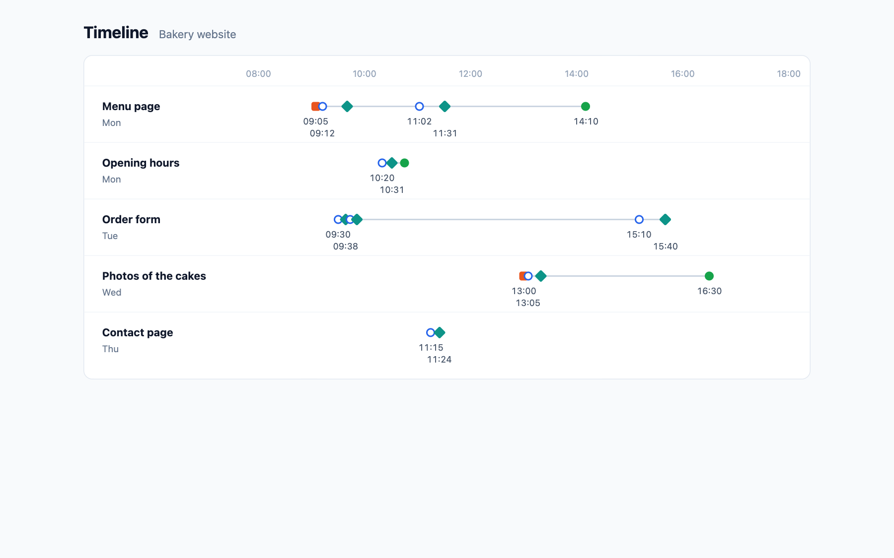

# Time labels overlap

<!-- status: PenEcho keeps this current -->
> [!status] Finished. The changes are on fix-time-labels, not merged
<!-- /status -->

## Ask · {{when -5 10:09}}

The times under the dots run into each other when steps are close together, see the circle. Fix it so they stay readable.

## [x] Work 1 · @claude · 8 min

**Fixed.** A time that would run into the one before it now moves to a second row, and when that row is full too it waits until you point at its dot. On the Order form line, 09:30 and 09:38 show; 09:44 and 09:52 show when you point at them.

- Added `labels.js`, which `timeline.js` now uses
- Added `labels.test.js`: 3 tests, all pass
- Changed `style.css`: rows are 12 px taller, for the second row of times

[Details](../works/time-labels-overlap/work-1.md)
