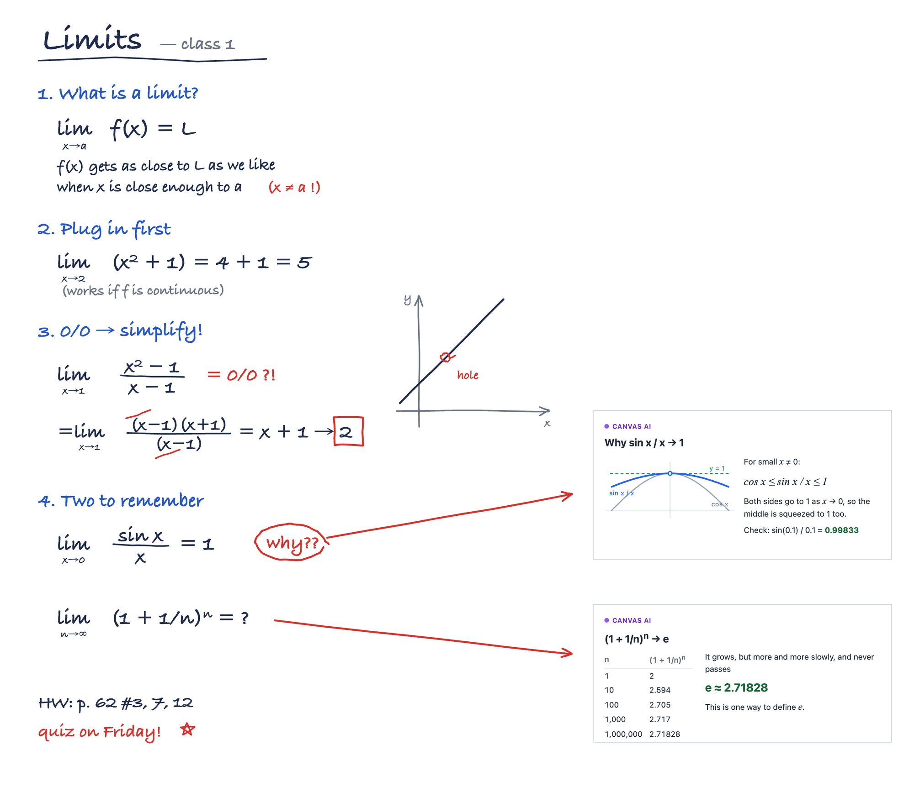

# Class 1 · Limits

<!-- status: PenEcho keeps this current -->
> [!status] Done, in the docs folder
<!-- /status -->

## Canvas · {{when -4 09:05}}

## Ask · {{when -4 12:40}}

Summarize today's class into a note I can study from before the exam. Keep the formulas and the examples.

> On the Canvas [Class 1 · Limits](../files/class-1-limits/class-1.penecho.json)

## [x] Work 1 · @dsh · 3 min

Your note on limits is ready: four ideas, the two worked examples from the board, and the two answers Canvas AI wrote beside your questions.

**What a limit is.** $\lim_{x\to a} f(x) = L$ means $f(x)$ gets as close to $L$ as you like when $x$ is close enough to $a$. What happens at $x = a$ itself does not matter.

**Plug in first.** If $f$ is continuous at $a$, the limit is just $f(a)$: $\lim_{x\to 2}(x^2+1) = 5$.

**When you get $\frac{0}{0}$, simplify.** $\lim_{x\to 1}\frac{x^2-1}{x-1} = \lim_{x\to 1}(x+1) = 2$.

**Two limits to know.** $\lim_{x\to 0}\frac{\sin x}{x} = 1$ (squeeze: $\cos x \le \frac{\sin x}{x} \le 1$), and $\lim_{n\to\infty}\left(1+\frac1n\right)^n = e \approx 2.718$.

[limits-notes.md](../files/class-1-limits/limits-notes.md)

[Details](../works/class-1-limits/work-1.md)
