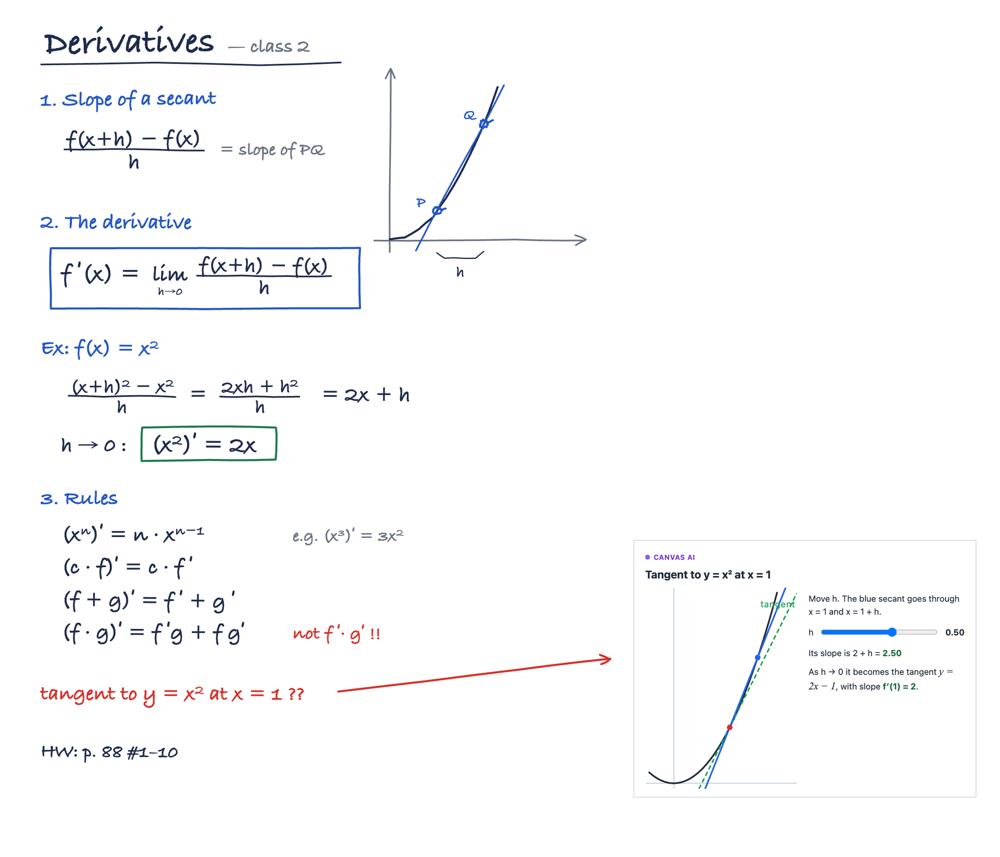
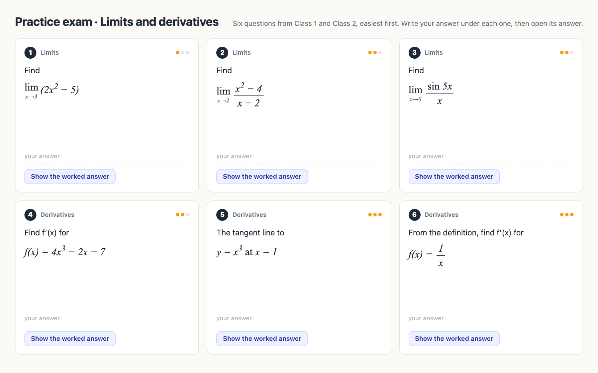

# Class 2 · Derivatives

<!-- status: PenEcho keeps this current -->
> [!status] Done, in the docs folder
<!-- /status -->

## Canvas · {{when -2 09:05}}

## Ask · {{when -2 12:35}}

Make notes from this class, like last time.

> On the Canvas [Class 2 · Derivatives](../files/class-2-derivatives/class-2.penecho.json)

> Refers to [Work 1](../works/class-1-limits/work-1.md): Your note on limits is ready: four ideas, the two worked examples from the board, and the two answers Canvas AI wrote beside your questions.

## [x] Work 1 · @dsh · 3 min

Your note on derivatives is ready, in the same form as the one on limits.

**The derivative is a limit.** $f'(x) = \lim_{h\to 0}\frac{f(x+h)-f(x)}{h}$: the slope of the secant line as its two points come together.

**From the board.** For $f(x) = x^2$: $\frac{(x+h)^2 - x^2}{h} = 2x + h \to 2x$.

**Rules.** $(x^n)' = n x^{n-1}$, $(cf)' = c f'$, $(f+g)' = f' + g'$, $(fg)' = f'g + fg'$.

**Tangent line.** At $x = a$: $y = f(a) + f'(a)(x-a)$. For $x^2$ at $a = 1$: $y = 2x - 1$, as Canvas AI drew it.

[derivatives-notes.md](../files/class-2-derivatives/derivatives-notes.md)

[Details](../works/class-2-derivatives/work-1.md)

## Ask · {{when -1 16:10}}

Give me a practice exam on the Canvas from both classes: six questions, harder towards the end, with worked answers I can open one at a time.

> Refers to [Work 1](../works/class-1-limits/work-1.md): Your note on limits is ready: four ideas, the two worked examples from the board, and the two answers Canvas AI wrote beside your questions.

## [x] Work 2 · @dsh · 4 min

The practice exam is on the Canvas: six questions, three on limits and three on derivatives, from easy to hard. Write your answer beside each one, then open its worked answer.

[Details](../works/class-2-derivatives/work-2.md)
