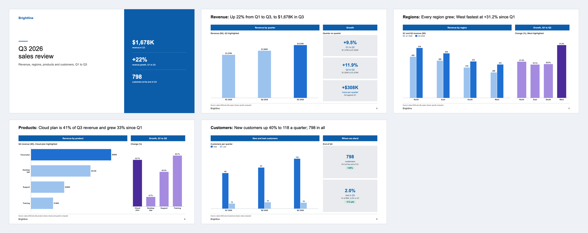
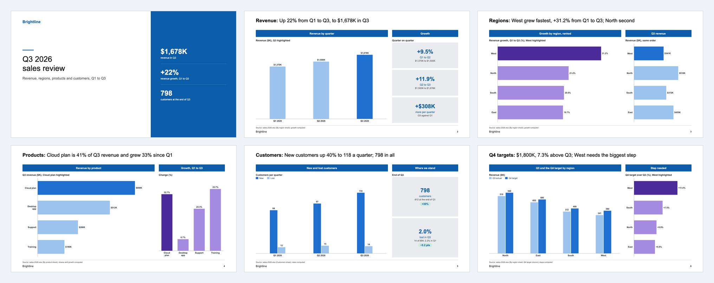

# Q3 sales review deck

<!-- status: PenEcho keeps this current -->
> [!status] Done, in the docs folder
<!-- /status -->

## Ask · {{when -2 14:20}}

Make a deck for Monday's sales review from this spreadsheet. Put it on the Canvas so I can download it as PPT.

[sales-2026.xlsx](../files/q3-sales-review-deck/sales-2026.xlsx)

## [x] Work 1 · @penecho · 7 min

Five slides are on the Canvas, made from all three sheets of sales-2026.xlsx with the investor template: the cover, revenue by quarter, regions, products and customers.

Download PPT on the deck's card saves it as one PowerPoint file. Its charts are real PowerPoint charts, so the numbers can still be changed there.

[Details](../works/q3-sales-review-deck/work-1.md)

## Ask · {{when -2 16:05}}

Two changes: show the regions as a ranking by growth with West first, and add a last slide with the Q4 targets by region.

## [x] Work 2 · @penecho · 4 min

Both changes are on the Canvas. Slide 3 now ranks the regions by growth, West first and highlighted at +31.2%. Slide 6 is new: Q4 targets by region next to Q3, with West needing the biggest step, +11.4%.

[Details](../works/q3-sales-review-deck/work-2.md)
